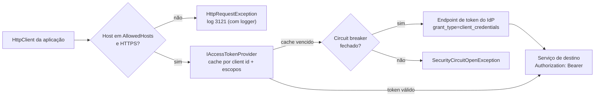

[🏠 TEC.Security](../README.md) › [📚 Documentação](README.md) › 🔁 Chamadas entre serviços

# 🔁 Chamadas entre serviços

> Como um serviço chama outro com o token da própria aplicação (OAuth 2.0 client credentials), sem segredo na configuração
> e sem o token escapar para outro host, e como escrever um provedor de token próprio com cache e circuit breaker.

## 📑 Sumário

- [🎯 Visão geral](#-visão-geral)
- [🚀 Uso](#-uso)
  - [Identidade da aplicação](#identidade-da-aplicação)
  - [Client credentials num HttpClient](#client-credentials-num-httpclient)
  - [Token direto, sem HttpClient](#token-direto-sem-httpclient)
  - [Provedor de token próprio](#provedor-de-token-próprio)
  - [Resiliência: circuit breaker](#resiliência-circuit-breaker)
  - [Tratar a falha do provedor](#tratar-a-falha-do-provedor)
- [⚙️ Opções](#️-opções)
- [❌ Erros](#-erros)
- [🛡️ Segurança](#️-segurança)
- [❓ Perguntas frequentes](#-perguntas-frequentes)

---

## 🎯 Visão geral



| Peça | Pacote | Papel |
|---|---|---|
| `AddOpenIdConnectClient` / `OpenIdConnectAccessTokenProvider` | `TEC.Security.OpenIdConnect` | Obtém o token por client credentials (segredo no TEC.Vault), com cache e circuit breaker |
| `AddOpenIdConnectAccessToken` | `TEC.Security.OpenIdConnect` | Anexa o token a um `HttpClient` (`IHttpClientBuilder`) |
| `AccessTokenHandler` / `AccessTokenHandlerOptions` | `TEC.Security` | `DelegatingHandler` genérico: anexa o `Bearer` só aos `AllowedHosts`, com HTTPS |
| `CachingAccessTokenProvider` | `TEC.Security` | Base para provedores de token próprios |
| `SecurityCircuitBreaker` | `TEC.Security` | Circuito sobre `Polly.Core` para o endpoint de token |

O destino vê uma identidade de **aplicação** (token sem usuário). Não há On-Behalf-Of: o token do usuário da requisição nunca é
repassado nem trocado.

---

## 🚀 Uso

### Identidade da aplicação

```csharp
using TEC.Security.Abstractions;
using TEC.Security.DependencyInjection;
using TEC.Security.OpenIdConnect;

builder.Services.AddTecSecurity(builder.Configuration, security => security
    .AddOpenIdConnectClient(options =>
    {
        options.TokenEndpoint = "https://auth.empresa.com/realms/corporativo/protocol/openid-connect/token";
        options.ClientId = "servico-faturamento";
        options.ClientSecretName = "segredo-faturamento";   // lido do TEC.Vault (ISecretReader) a cada obtenção de token
    }));

// Limitação atual: o AddOpenIdConnectClient registra o IAccessTokenProvider como cliente tipado do HttpClient e o container
// não consegue resolvê-lo (falta OpenIdConnectClientOptions). Registre o provedor à mão, depois do AddTecSecurity:
builder.Services.AddSingleton<IAccessTokenProvider>(sp => sp.GetRequiredService<OpenIdConnectAccessTokenProvider>());
```

Funciona também em workers (não depende de `AddAspNetCore`). Registre o TEC.Vault (`AddTecVault(...)`) para o `ClientSecretName`.
Sem `TokenEndpoint`, o endpoint é `{Authority}/protocol/openid-connect/token` (padrão do Keycloak); no Entra ID informe
`https://login.microsoftonline.com/<tenant-id>/oauth2/v2.0/token` ([🪪 Provedor Entra ID](provedor-entra-id.md#chamar-outras-apis)).

> [!WARNING]
> Sem o registro explícito do `IAccessTokenProvider`, a resolução do `AddOpenIdConnectAccessToken` falha com
> `Unable to resolve service for type 'OpenIdConnectClientOptions'`.

### Client credentials num HttpClient

```csharp
builder.Services.AddHttpClient<EstoqueClient>(c => c.BaseAddress = new Uri("https://estoque.empresa.com/"))
    .AddOpenIdConnectAccessToken(o =>
    {
        o.Scopes.Add("estoque.consultar");          // no Entra ID: "api://<client-id-do-estoque>/.default"
        o.AllowedHosts.Add("estoque.empresa.com");
    });
```

- O token é obtido uma vez por *client id* + escopos e reaproveitado até perto da expiração; chamadas simultâneas disparam uma
  única obtenção (uma trava por conjunto de escopos).
- A renovação começa `min(5 minutos, 1/4 da validade)` antes de expirar: tokens curtos (ex.: 5 minutos) também são reaproveitados.
- Um header `Authorization` já presente na requisição é mantido (o handler não sobrescreve nem consulta o provedor).
- Falha na obtenção chega como exceção do provedor (ver [Erros](#-erros)); o provedor OpenID Connect **não** mantém o token
  vencido nem usa o token atual quando a renovação falha.

### Token direto, sem HttpClient

```csharp
using TEC.Security.Abstractions;

public sealed class Exportador(IAccessTokenProvider tokens)
{
    public async Task<string> TokenAsync(CancellationToken cancellationToken)
    {
        AccessToken token = await tokens.GetTokenAsync(["estoque.consultar"], cancellationToken);
        return token.Token;   // ToString() do AccessToken mascara o valor; nunca registre token.Token
    }
}
```

### Provedor de token próprio

Para outro IdP, herde `CachingAccessTokenProvider` (cache, renovação, uma obtenção por conjunto de escopos, métricas, log sem o
token e fallback para o token atual já vêm prontos) e use o `AccessTokenHandler` genérico:

```csharp
using Microsoft.Extensions.Logging;
using TEC.Security.Abstractions;
using TEC.Security.Tokens;

public sealed class KeycloakTokenProvider(IHttpClientFactory http, TimeProvider time, ILogger<KeycloakTokenProvider> logger)
    : CachingAccessTokenProvider("Keycloak", time, logger)
{
    protected override async ValueTask<AccessToken> AcquireTokenAsync(IReadOnlyList<string> scopes, CancellationToken cancellationToken)
    {
        var client = http.CreateClient("keycloak");
        // ... chama o endpoint de token do seu IdP e lê access_token/expires_in com teto de tamanho
        // Tokens curtos (ex.: 5 minutos, padrão do Keycloak) também são reaproveitados: renovação com 1/4 da validade restante
        long expiresIn = 3600;   // expires_in da resposta
        return new AccessToken("<token>", time.GetUtcNow().AddSeconds(expiresIn));
    }
}

builder.Services.AddSingleton<IAccessTokenProvider, KeycloakTokenProvider>();
builder.Services.AddHttpClient("relatorios", c => c.BaseAddress = new Uri("https://relatorios.contoso.com/"))
    .AddHttpMessageHandler(sp =>
    {
        var opcoes = new AccessTokenHandlerOptions();
        opcoes.Scopes.Add("relatorios");
        opcoes.AllowedHosts.Add("relatorios.contoso.com");
        return new AccessTokenHandler(sp.GetRequiredService<IAccessTokenProvider>(), opcoes,
            sp.GetService<ILogger<AccessTokenHandler>>());
    });
```

Com a base `CachingAccessTokenProvider`, se a renovação falhar e o token atual ainda valer mais de **30 segundos**, ele continua
em uso (log 3122): uma instabilidade passageira do IdP não derruba as chamadas. Sem token utilizável, a falha vira
`SecurityTokenAcquisitionException` (log 3120).

### Resiliência: circuit breaker

O `OpenIdConnectAccessTokenProvider` cria um `SecurityCircuitBreaker` (`Polly.Core`, nome `OpenIdConnect.M2M` nas métricas e
logs) em volta do pedido ao endpoint de token, ligado por padrão (`OpenIdConnectClientOptions.Resilience`):

- Com falhas demais na janela, o circuito abre: as chamadas seguintes lançam `SecurityCircuitOpenException` na hora, sem
  chegar ao IdP, até o fim da pausa; depois uma chamada de teste (meia-abertura) fecha o circuito se funcionar.
- Cancelamento pedido pelo chamador não abre o circuito; na chamada de teste conta como falha. Tempo limite do pedido
  (`Timeout`, 10 s) é falha do destino.
- Não há retentativa no provedor OpenID Connect: uma falha é lançada uma vez; o que repete é a aplicação.

```json
{ "Resilience": { "Enabled": true, "FailureRatio": 0.5, "MinimumThroughput": 10, "SamplingDuration": "00:00:30", "BreakDuration": "00:00:30" } }
```

(`OpenIdConnectClientOptions` é configurado em código: `options.Resilience.BreakDuration = TimeSpan.FromSeconds(60)`.)

Num provedor de token próprio, passe um `SecurityCircuitBreaker` ao construtor de `CachingAccessTokenProvider`: aberto, a
renovação falha na hora e a regra do token atual continua valendo, e a exceção chega como `SecurityTokenAcquisitionException`
com `SecurityCircuitOpenException` em `InnerException`.

### Tratar a falha do provedor

`SecurityTokenAcquisitionException` (provedores baseados em `CachingAccessTokenProvider`) deriva de `AppException` do TEC.Core
(código `SEGURANCA_PROVEDOR_INDISPONIVEL`, HTTP 502, mensagem genérica). Converta em `Result` com `ToResult()`:

```csharp
using TEC.Core.Common.Results;
using TEC.Security.Tokens;

public async Task<Result> SincronizarAsync(CancellationToken cancellationToken)
{
    try
    {
        await estoque.EnviarAsync(cancellationToken);
        return Result.Success();
    }
    catch (SecurityTokenAcquisitionException exception)
    {
        return exception.ToResult();   // exception.Code == "SEGURANCA_PROVEDOR_INDISPONIVEL"; causa em InnerException
    }
}
```

Dentro de um handler do TEC.Cqrs nem o `try` é necessário: o comportamento de exceções converte qualquer `AppException` em
`Result` (e o TEC.Cqrs.AspNetCore responde 502 padronizado). O provedor OpenID Connect lança `InvalidOperationException` e
`SecurityCircuitOpenException` direto: capture-as se quiser o mesmo tratamento.

---

## ⚙️ Opções

**`OpenIdConnectClientOptions`** (`AddOpenIdConnectClient`, só em código)

| Opção | Padrão | Descrição |
|---|---|---|
| `Authority` | vazio | Base para inferir o endpoint de token (`{Authority}/protocol/openid-connect/token`) |
| `TokenEndpoint` | `null` | Endpoint de token direto; informe `TokenEndpoint` ou `Authority` |
| `ClientId` | — (obrigatório) | Client id da aplicação |
| `ClientSecretName` / `ClientSecret` | `null` | Segredo no TEC.Vault (preferido) ou direto; um dos dois é obrigatório |
| `Timeout` | 10 s | Tempo limite do pedido ao endpoint de token |
| `Resilience` | ligado | `SecurityCircuitBreakerOptions` (abaixo) |
| `AuthType`, `CertificateName` | `ClientSecret`, `null` | Sem efeito: `PrivateKeyJwt` não está implementado |

**`SecurityCircuitBreakerOptions`** (`TEC.Security.Resilience`)

| Opção | Padrão | Descrição |
|---|---|---|
| `Enabled` | `true` | Liga o circuit breaker |
| `FailureRatio` | `0.5` | Proporção de falhas que abre o circuito (> 0 e ≤ 1) |
| `MinimumThroughput` | `10` | Mínimo de chamadas na janela (2 a 10.000) |
| `SamplingDuration` | `30 s` | Janela de amostragem (0,5 s a 1 h) |
| `BreakDuration` | `30 s` | Tempo aberto antes da chamada de teste (0,5 s a 1 h) |

**`AccessTokenHandlerOptions`** (`TEC.Security.Tokens`)

| Opção | Padrão | Descrição |
|---|---|---|
| `Scopes` | vazio | Escopos pedidos (ex.: `api://<client-id>/.default`). Obrigatório |
| `AllowedHosts` | vazio | Hosts que podem receber o token (host IDN, sem diferenciar maiúsculas). Entrada sem porta vale só para a porta padrão (443 em HTTPS, 80 em HTTP); `host:porta` vale só para aquela porta (SEC-14). Obrigatório |
| `AllowHttpForLoopback` | `false` | Aceita HTTP para `localhost`/loopback (desenvolvimento) |
| `IsAllowedDestination(Uri?)` | — | `true` se o token pode ir para o destino: absoluto, sem usuário na URL, HTTPS (ou loopback permitido) e host (e porta) na lista |
| `Validate()` | — | Confere escopos e hosts (chamado no registro) |

**`CachingAccessTokenProvider`** (base abstrata, `IAccessTokenProvider`, `IDisposable`)

| Membro | Valor | Descrição |
|---|---|---|
| `RefreshBefore` | 5 minutos | Antecedência máxima da renovação; tokens curtos usam um quarto da validade (`RefreshMargin`) |
| Tempo limite do provedor | — | `OperationCanceledException` sem cancelamento do chamador (tempo limite do `HttpClient`) é falha: usa o token atual ainda válido, vira `SecurityTokenAcquisitionException` e conta para o circuit breaker |
| `MinimumRemainingLifetime` | 30 segundos | Validade restante mínima para continuar usando o token atual se a renovação falhar |
| `MaxScopeSets` | 1024 | Conjuntos de escopos distintos em cache |
| `ProviderName` | (construtor) | Nome nas métricas e logs |
| `circuitBreaker` | (construtor, opcional) | `SecurityCircuitBreaker` em volta de `AcquireTokenAsync` |
| `AcquireTokenAsync(scopes, ct)` | abstrato | Obtém um token novo, sem cache |

**Outros tipos:** `IAccessTokenProvider.GetTokenAsync(IReadOnlyList<string> scopes, CancellationToken)` →
`ValueTask<AccessToken>`; `AccessToken(string token, DateTimeOffset expiresOn)` com `Token`, `ExpiresOn` e `ToString()`
mascarado; `AccessTokenHandler(IAccessTokenProvider, AccessTokenHandlerOptions, ILogger<AccessTokenHandler>?)`;
`OpenIdConnectAccessTokenProvider` (cache por *client id* + escopos, circuit breaker, métricas `OpenIdConnect.M2M`).

---

## ❌ Erros

| Erro | Quando ocorre | O que fazer |
|---|---|---|
| `InvalidOperationException` (registro) | `AccessTokenHandlerOptions` sem escopo ou sem host válido | Informe `Scopes` e `AllowedHosts` |
| `InvalidOperationException` (resolução) | `Unable to resolve service for type 'OpenIdConnectClientOptions'` ao resolver `IAccessTokenProvider` | Registre o `IAccessTokenProvider` à mão (acima) |
| `InvalidOperationException` (primeira obtenção) | Sem `ClientId`; sem `TokenEndpoint` nem `Authority`; sem `ClientSecret`/`ClientSecretName`; `ISecretReader` não registrado; segredo não encontrado no cofre | Configure o cliente e o TEC.Vault |
| `InvalidOperationException`: `Falha ao obter token M2M ... HTTP <status>: <corpo>` | O endpoint de token recusou o pedido, ou a resposta não trouxe `access_token` | Leia o código OAuth no corpo (ex.: `invalid_client`); não registre a mensagem em log aberto |
| `SecurityCircuitOpenException` | Circuito aberto após falhas repetidas do endpoint de token | Aguarde a pausa; veja os logs 3123–3125 |
| `HttpRequestException` + log 3121 | Destino fora de `AllowedHosts`, sem HTTPS, com usuário na URL ou em porta não autorizada | Inclua o host (e a porta, se não for a padrão); `AllowHttpForLoopback` só em desenvolvimento |
| `SecurityTokenAcquisitionException` + log 3120 | Provedor baseado em `CachingAccessTokenProvider` falhou e não há token ainda válido (mais de 30 s) | Veja o tipo no log; confira credencial e acesso ao cofre |
| `InvalidOperationException`: `Mais de 1024 conjuntos de escopos distintos` | Escopos montados dinamicamente (`CachingAccessTokenProvider`) | Use conjuntos fixos |
| `ObjectDisposedException` | `GetTokenAsync` depois do `Dispose` de um `CachingAccessTokenProvider` | Não use o provedor depois de descartado |
| `ArgumentException` | `GetTokenAsync` sem escopo ou com escopo vazio (`CachingAccessTokenProvider`) | Informe escopos válidos |

---

## 🛡️ Segurança

> [!CAUTION]
> `AllowedHosts` é a proteção contra exfiltração do token (SSRF, URL adulterada, redirecionamento): o token dá acesso ao
> destino em nome da aplicação. Mantenha a lista mínima e sem hosts controlados por terceiros.

- Redirecionamentos: o `HttpClientHandler` remove o `Authorization` ao seguir um redirect, então o token não acompanha um
  302 para outro domínio.
- Portas: `api.contoso.com` na lista libera só a 443; `api.contoso.com:8443` libera só a 8443.
- A mensagem da exceção de falha do endpoint de token (provedor OpenID Connect) inclui o **corpo** da resposta do IdP: não a
  registre nem a devolva ao cliente.
- A resposta do endpoint de token do provedor OpenID Connect não tem teto de tamanho próprio além do tempo limite de 10 s.
- Mantenha o segredo no TEC.Vault; `ClientSecret` na configuração só como último recurso.

---

## ❓ Perguntas frequentes

<details>
<summary>Qual escopo uso em client credentials?</summary>

O que o seu IdP definir para o serviço de destino. No Entra ID, sempre `api://<client-id-do-destino>/.default`: o token traz
os app roles concedidos à sua aplicação na API de destino.

</details>

<details>
<summary>Posso chamar um serviço local por HTTP em desenvolvimento?</summary>

Sim, com `AllowHttpForLoopback = true` e `localhost` em `AllowedHosts`. Nunca habilite em produção.

</details>

<details>
<summary>Como o destino vê a chamada?</summary>

Como um token de aplicação do seu IdP. No TEC.Security do destino, o `Kind` é inferido pelo provedor OpenID Connect
([🌐 Provedor OpenID Connect](provedor-openid-connect.md#mapeamento-de-claims)); confira o aviso sobre tokens de aplicação
do Entra ID.

</details>

---
⬅️ [🪪 Provedor Entra ID](provedor-entra-id.md) · [📚 Índice](README.md) · [🔑 API keys](api-keys.md) ➡️
