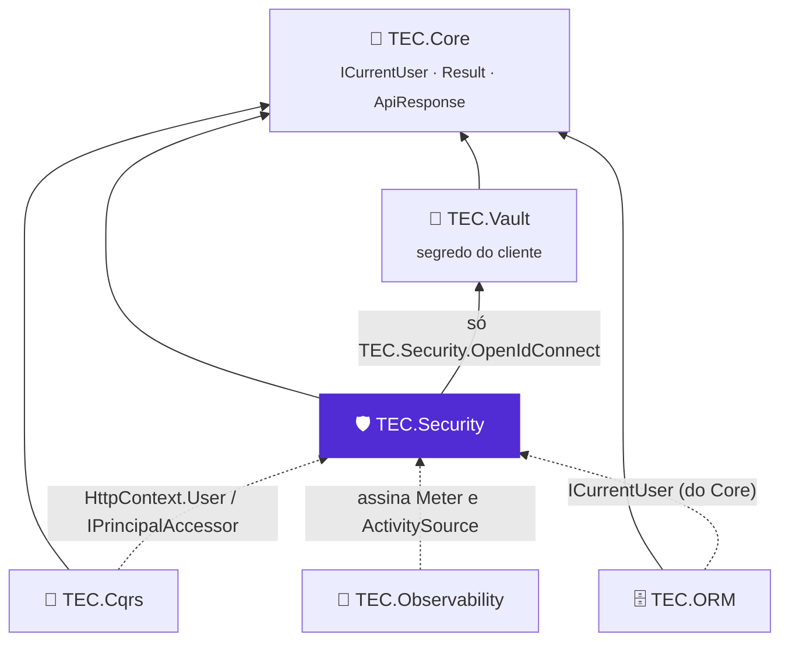

[🏠 TEC.Security](../README.md) › [📚 Documentação](README.md) › 🧬 Integrações TEC

# 🧬 Integrações TEC

> Como o TEC.Security se relaciona com os outros componentes do ecossistema: do que depende (TEC.Core, TEC.Vault) e como
> a identidade que ele normaliza chega ao TEC.Cqrs, ao TEC.ORM e ao TEC.Observability sem que eles dependam dele.

## 📑 Sumário

- [🎯 Visão geral](#-visão-geral)
- [🚀 Uso](#-uso)
  - [TEC.Core](#teccore)
  - [TEC.Vault](#tecvault)
  - [TEC.Cqrs](#teccqrs)
  - [TEC.ORM](#tecorm)
  - [TEC.Observability](#tecobservability)
- [⚙️ Opções](#️-opções)
- [❌ Erros](#-erros)
- [🛡️ Segurança](#️-segurança)
- [❓ Perguntas frequentes](#-perguntas-frequentes)

---

## 🎯 Visão geral



| Componente | Relação | O que o TEC.Security usa ou oferece |
|---|---|---|
| [TEC.Core](https://github.com/tudoemcodigo/lib-tec-core) | Dependência (`TEC.Security`) | `ICurrentUser`/`PrincipalKind`, `Result`/`Error`, `AppException`, `ApiResponse`, `SingleFlight`, `Base64UrlEncoder`, `SensitiveDataMasker`, `JsonDefaults` |
| [TEC.Vault](https://github.com/tudoemcodigo/lib-tec-vault) | Dependência (só `TEC.Security.OpenIdConnect`) | Client secret da aplicação (`ISecretReader`) no login web e nas chamadas entre serviços |
| [TEC.Cqrs](https://github.com/tudoemcodigo/lib-tec-cqrs) | Integração sem dependência | Identidade normalizada para `[AuthorizeRequest]` e `IPrincipalAccessor` |
| [TEC.ORM](https://github.com/tudoemcodigo/lib-tec-orm) | Integração sem dependência | Lê o `ICurrentUser` registrado pelo TEC.Security para a auditoria |
| [TEC.Observability](https://github.com/tudoemcodigo/lib-tec-observability) | Integração sem dependência | Exporta o Meter e o ActivitySource `TEC.Security` |

Cqrs, Security e Observability são independentes entre si: nenhum referencia o outro.

---

## 🚀 Uso

### TEC.Core

| Recurso do TEC.Core | Uso no TEC.Security |
|---|---|
| `ICurrentUser`, `PrincipalKind` | Contrato mínimo de **quem executa**: o TEC.Security o implementa e registra como Scoped (a mesma instância do `ISecurityUser`) |
| `Result`/`Error` | Retorno de `SecurityIdentityFactory` e `ISecurityContext`, com os códigos de [`SecurityErrors`](erros.md) |
| `ApiResponse`, `ApiError`, `ApiResponse.DefaultMessages` | Corpo e textos das respostas 401/403 (mesmo formato do TEC.Cqrs.AspNetCore) e mensagem do erro de provedor |
| `AppException` | Base da `SecurityTokenAcquisitionException` (`ToResult()`, `Errors`, `Code`) |
| `SingleFlight<TKey, TValue>` | Uma consulta por chave no cache de permissões |
| `Base64UrlEncoder` | Segredo e hash das API keys (estrito e canônico) e chave do cache de permissões |
| `SensitiveDataMasker.DescribeUntrusted` | Caminho da requisição na auditoria quando não há endpoint e claim de tenant recusado pelo provedor OpenID Connect (só tamanho + HMAC) |
| `JsonDefaults` | Serialização do corpo 401/403 com metadados gerados (AOT) |

### TEC.Vault

O segredo do cliente OAuth fica no cofre, e só o **nome** vai para o código ou a configuração:

| Onde | Opção | O que sai do cofre |
|---|---|---|
| Chamadas entre serviços | `OpenIdConnectClientOptions.ClientSecretName` | O segredo (`ISecretReader.GetSecretAsync`), lido a cada obtenção de token |
| Login web | `OpenIdConnectWebLoginOptions.ClientSecretName` | O segredo, conferido na subida (precisa existir) e lido de novo a cada login, na troca do código e no pedido por PAR; acompanha a rotação sem reiniciar |

```csharp
using TEC.Security.DependencyInjection;
using TEC.Security.OpenIdConnect;
using TEC.Vault.AzureKeyVault;
using TEC.Vault.DependencyInjection;

builder.Services.AddTecVault(vault => vault.UseAzureKeyVault(o =>
    o.VaultUri = new Uri("https://<nome-do-cofre>.vault.azure.net/")));

builder.Services.AddTecSecurity(builder.Configuration, security => security
    .AddAspNetCore()
    .AddOpenIdConnectWebLogin("Web", o =>
    {
        o.Authority = "https://auth.empresa.com/realms/corporativo";
        o.ClientId = "portal-web";
        o.ClientSecretName = "portal-web-secret";
    }));
```

Papel mínimo no Azure Key Vault: *Key Vault Secrets User*. A credencial por certificado (client assertion assinada no cofre) não
está implementada.

### TEC.Cqrs

- APIs: `[AuthorizeRequest(Roles = "...")]` e as policies de `[AuthorizeRequest(Policy = "...")]` avaliam o
  `HttpContext.User`, que já é a identidade normalizada (`RoleClaimType = tec_role`).
- Permissões no pipeline: registre uma policy por permissão (ex.:
  `o.AddPolicy("pedidos:cancelar", p => p.RequireClaim(TecClaimTypes.Permission, "pedidos:cancelar"))`) ou use um
  `IRequestAuthorizer<T>` com `ISecurityUser.HasPermission(...)`.
- Workers (inclusive `BackgroundService` dentro da API): registre um `IPrincipalAccessor` sobre o `ISecurityUser`
  ([🤖 Workers](workers.md#teccqrs-fora-do-http)).
- `SecurityTokenAcquisitionException` (provedores baseados em `CachingAccessTokenProvider`) é uma `AppException`: o TEC.Cqrs a converte em `Result` (502).

### TEC.ORM

O TEC.ORM **não** referencia o TEC.Security: consome o `ICurrentUser` do TEC.Core, que o TEC.Security registra. Assim o
ORM continua sem ASP.NET Core e sem provedor de identidade, funciona em workers (identidade de sistema) e em testes (um `ICurrentUser`
falso).

| Campo de `IAuditable` | Valor |
|---|---|
| `CreatedBy` / `UpdatedBy` / `DeletedBy` | `ICurrentUser.Id` (`sub`, `apikey:{id}`, `system:{nome}`), nunca nome ou e-mail |
| `CreatedByTenant` / `UpdatedByTenant` / `DeletedByTenant` | `ICurrentUser.TenantId` no momento da operação |

Sem identidade autenticada, a gravação de entidade auditada é recusada (`ORM_AUDITORIA_SEM_IDENTIDADE`). Referência:
[auditoria do TEC.ORM](https://github.com/tudoemcodigo/lib-tec-orm/blob/main/docs/auditoria.md).

### TEC.Observability

`AddTecObservability` assina as fontes `TEC.*`: o Meter e o ActivitySource `TEC.Security` entram sem configuração
([📈 Observabilidade](observabilidade.md)). Com hubs SignalR o token vai na query string: o TEC.Observability redige os
valores da query string nos traces, mas confira os logs de acesso de proxies e do servidor.

---

## ⚙️ Opções

| Integração | Configuração |
|---|---|
| TEC.Core | Nenhuma (dependência direta) |
| TEC.Vault | `AddTecVault(...)` com um provedor de segredos; `ClientSecretName` nas opções do login web e do cliente OpenID Connect |
| TEC.Cqrs | `IPrincipalAccessor` em workers; policies por permissão |
| TEC.ORM | Nenhuma: o `ICurrentUser` já está registrado |
| TEC.Observability | Nenhuma; sem ele: `AddSource(SecurityDiagnostics.ActivitySourceName)` e `AddMeter(SecurityDiagnostics.MeterName)` |

---

## ❌ Erros

| Erro | Quando ocorre | O que fazer |
|---|---|---|
| `OptionsValidationException`: `ClientSecretName informado, mas nenhum ISecretReader (TEC.Vault) está registrado` | `ClientSecretName` sem o TEC.Vault registrado; a aplicação não sobe | Registre o TEC.Vault com o provedor do cofre |
| `InvalidOperationException`: `Segredo '<nome>' não encontrado no cofre TEC.Vault` | Item inexistente, sem permissão ou desabilitado (nas chamadas de serviço, dentro de `SecurityTokenAcquisitionException`) | Confira o nome e os papéis no cofre |
| 401 em `Send` do TEC.Cqrs num worker | `IPrincipalAccessor` lendo só o `HttpContext` | Veja [🤖 Workers](workers.md#teccqrs-fora-do-http) |
| `ORM_AUDITORIA_SEM_IDENTIDADE` | Gravação auditada sem identidade (ex.: job sem `RunAs`) | Use uma identidade de sistema |

Nas chamadas de serviço, as falhas de credencial chegam como `SecurityTokenAcquisitionException` com a
`InvalidOperationException` original em `InnerException` ([🔁 Chamadas entre serviços](chamadas-entre-servicos.md#-erros)).

---

## 🛡️ Segurança

> [!IMPORTANT]
> Os campos "por tenant" da auditoria do TEC.ORM são informativos: o ORM **não** filtra linhas por tenant. O isolamento
> de dados entre tenants é responsabilidade da aplicação ([🏢 Tenants](tenants.md#️-segurança)).

- Conceda à identidade da aplicação só o papel mínimo no cofre (*Secrets User*).
- Traces e métricas do TEC.Security não levam token, id de usuário, nome nem e-mail: podem ir para terceiros.

---

## ❓ Perguntas frequentes

<details>
<summary>Preciso do TEC.Vault para usar o TEC.Security?</summary>

Só o `TEC.Security.OpenIdConnect` depende dele. O pacote sempre traz o TEC.Vault como dependência, mas você só precisa
registrá-lo (`AddTecVault`) quando usa `ClientSecretName`. O núcleo, o `TEC.Security.AspNetCore`
e o `TEC.Security.Testing` não o usam.

</details>

<details>
<summary>O TEC.Cqrs precisa referenciar o TEC.Security?</summary>

Não: ele avalia o `ClaimsPrincipal` (normalizado pelo TEC.Security) pelo `IPrincipalAccessor`.

</details>

---
⬅️ [🧱 Novo provedor](novo-provedor.md) · [📚 Índice](README.md) · [📈 Observabilidade](observabilidade.md) ➡️
