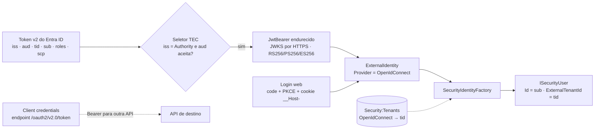

[🏠 TEC.Security](../README.md) › [📚 Documentação](README.md) › 🪪 Provedor Entra ID

# 🪪 Provedor Microsoft Entra ID

> Como proteger APIs e sites com tokens do Microsoft Entra ID, fazer login web e chamar outras APIs com client credentials
> usando o `TEC.Security.OpenIdConnect`. Descreve só o que o código implementa hoje.

## 📑 Sumário

- [🎯 Visão geral](#-visão-geral)
- [🚀 Uso](#-uso)
  - [App registration da API](#app-registration-da-api)
  - [Proteger a API](#proteger-a-api)
  - [Claims do token](#claims-do-token)
  - [Multi-tenant](#multi-tenant)
  - [Várias app registrations](#várias-app-registrations)
  - [Login web](#login-web)
  - [Credencial da aplicação](#credencial-da-aplicação)
  - [Chamar outras APIs](#chamar-outras-apis)
  - [O que não existe](#o-que-não-existe)
- [⚙️ Opções](#️-opções)
- [❌ Erros](#-erros)
- [🛡️ Segurança](#️-segurança)
- [❓ Perguntas frequentes](#-perguntas-frequentes)

---

## 🎯 Visão geral

O Entra ID é um servidor OpenID Connect padrão: o TEC.Security o atende com o provedor agnóstico
[`TEC.Security.OpenIdConnect`](provedor-openid-connect.md). **Não há pacote nem tipo de provedor específico do Entra ID**:
as identidades chegam com `Provider = "OpenIdConnect"` e é essa a chave em `Security:Tenants:*:IdentityProviders`.



| Recurso | Método | Pacote |
|---|---|---|
| API protegida por access token | `AddOpenIdConnectApi` | `TEC.Security.OpenIdConnect` |
| Login web (Authorization Code + PKCE) | `AddOpenIdConnectWebLogin` + `MapTecWebLogin` | `TEC.Security.OpenIdConnect` / `TEC.Security.AspNetCore` |
| Chamar outra API (client credentials) | `AddOpenIdConnectClient` + `AddOpenIdConnectAccessToken` | `TEC.Security.OpenIdConnect` |

---

## 🚀 Uso

### App registration da API

No portal do Entra ID (*App registrations*):

| Item | Valor |
|---|---|
| *Application ID URI* | Opcional (ex.: `api://<client-id-da-api>`); os escopos delegados e o `/.default` usam esse prefixo |
| `requestedAccessTokenVersion` (manifesto) | `2`. Com tokens v1 o `iss` é `https://sts.windows.net/<tenant-id>/` e **não** bate com a `Authority` v2 |
| App roles | Os papéis que a API usa (`roles` no token); atribua a usuários, grupos ou aplicações |
| *Expose an API* | Escopos delegados (ex.: `access_as_user`), que chegam no claim `scp` |

> [!IMPORTANT]
> O emissor aceito é exatamente a `Authority` (com ou sem `/` no fim). Use a versão 2: `https://login.microsoftonline.com/<tenant-id>/v2.0`.

### Proteger a API

```json
{
  "Security": {
    "RequireTenant": true,
    "RolesAsPermissions": false,
    "OpenIdConnect": {
      "Entra": {
        "Authority": "https://login.microsoftonline.com/<tenant-id>/v2.0",
        "Audience": "<client-id-da-api>",
        "MultiTenant": true
      }
    },
    "Tenants": {
      "contoso": { "Name": "Contoso Ltda", "IdentityProviders": { "OpenIdConnect": [ "<tenant-id>" ] } }
    },
    "Permissions": {
      "Roles": { "Gerente": [ "pedidos:ler", "pedidos:cancelar" ] }
    }
  }
}
```

```csharp
using TEC.Security.Abstractions;
using TEC.Security.AspNetCore;
using TEC.Security.AspNetCore.Authorization;
using TEC.Security.DependencyInjection;
using TEC.Security.OpenIdConnect;

builder.Services.AddTecSecurity(builder.Configuration, security => security
    .AddAspNetCore()
    .AddOpenIdConnectApi("Funcionarios", builder.Configuration.GetSection("Security:OpenIdConnect:Entra")));

app.MapGet("/pedidos", (ISecurityUser usuario) => usuario.TenantId)
   .RequireTecAuthorization(permissions: "pedidos:ler");
```

- `Audience` (ou `Audiences`) é o valor que o claim `aud` traz: o *client id* da API em tokens v2 e, quando o token usa o
  *Application ID URI*, o `api://...` correspondente. Informe os dois em `Audiences` se a API recebe ambos.
- O `ISecurityUser.Provider` é `OpenIdConnect` e o `Scheme` é o nome informado (`Funcionarios`).
- Com `RolesAsPermissions` não definido, os app roles também viram permissões ([👤 Identidade e permissões](identidade-e-permissoes.md#permissões-por-papel-no-appsettings)).
  Em APIs multi-tenant defina `false` e mapeie papéis em `Security:Permissions` ([🏢 Tenants](tenants.md#️-segurança)).

### Claims do token

O `TEC.Security.OpenIdConnect` converte o access token validado em `ExternalIdentity` (o primeiro valor de cada tipo vence):

| Claim do token | Vira | Observação |
|---|---|---|
| `sub` | `ISecurityUser.Id` | No Entra ID o `sub` é **específico por aplicação**: o mesmo usuário tem `sub` diferente em outra API. O `oid` não é lido. Sem `sub`, o token é recusado |
| `tid` (ou `tenant_id`, `tenant`, ou o claim de `TenantClaim`) | `ExternalTenantId` | Resolvido no cadastro de tenants pelo provedor `OpenIdConnect` |
| `roles` (ou `role`, ou o claim de `RoleClaimType`) | `Roles` | Valor simples ou array JSON; também lê `realm_access`/`resource_access` do Keycloak |
| `scp` (ou `scope`) | `Scopes` | Separados por espaço |
| `preferred_username` (ou `name`, ou o claim de `NameClaimType`) | `Name` | Só exibição; sem nome, usa o `sub` |
| `iss`, `aud`, `exp`, assinatura | Validação | Sempre validados; veja [🛡️ Segurança](seguranca.md#controles-obrigatórios-conferidos-na-subida) |

Não são lidos: `oid`, `azp`/`appid`, `idtyp`, `groups` e demais claims. Os claims originais **não** são copiados para
`ISecurityUser.Principal` pelo provedor OpenID Connect.

**Tipo da identidade (`Kind`).** É inferido: `Application` quando o token **não** tem papéis, tem `scope`/`scp` e não tem `email`
nem `preferred_username`; qualquer outro caso é `User`.

> [!WARNING]
> Um token de aplicação do Entra ID (client credentials) traz `roles` e não traz `scp`, então chega como `User`. Endpoints
> com `Kinds = TecPrincipalKinds.Application` recusam esse token; use `Kinds = TecPrincipalKinds.UserOrApplication` (o padrão)
> e `Permissions`/`Roles` para aceitá-lo.

### Multi-tenant

Com `MultiTenant = true`, a identidade só é aceita se o `tid` (ou, sem claim de tenant, o `iss`) estiver cadastrado e **ativo**
em `Security:Tenants` para o provedor `OpenIdConnect`; senão o token é recusado (401). Sem `MultiTenant`, o tenant é resolvido
quando o `tid` está cadastrado; um tenant inativo continua recusado, e `RequireTenant` recusa a identidade sem tenant.

```json
"Tenants": {
  "contoso":  { "IdentityProviders": { "OpenIdConnect": [ "<tenant-id-da-contoso>" ] } },
  "fabrikam": { "Enabled": false, "IdentityProviders": { "OpenIdConnect": [ "<tenant-id-da-fabrikam>" ] } }
}
```

> [!NOTE]
> `MultiTenant` não muda a validação do emissor: o `iss` do token continua precisando ser igual à `Authority`. Uma `Authority`
> com `common` ou `organizations` não funciona, porque o `iss` dos tokens carrega o `tid` de cada tenant. Na prática, o
> cadastro de tenants decide quais tenants **do mesmo emissor** são aceitos.

### Várias app registrations

Chame `AddOpenIdConnectApi` uma vez por API, com esquemas diferentes. O seletor percorre os provedores na ordem de registro e
escolhe o primeiro cujo emissor é igual à `Authority` (qualquer emissor, se `MultiTenant`) **e** cuja audiência está em
`Audience`/`Audiences`:

```csharp
security
    .AddAspNetCore()
    .AddOpenIdConnectApi("Pedidos", o => { o.Authority = authority; o.Audience = "<client-id-pedidos>"; })
    .AddOpenIdConnectApi("Estoque", o => { o.Authority = authority; o.Audience = "<client-id-estoque>"; });
```

### Login web

```csharp
builder.Services.AddTecSecurity(builder.Configuration, security => security
    .AddAspNetCore()
    .AddOpenIdConnectWebLogin("Web", o =>
    {
        o.Authority = "https://login.microsoftonline.com/<tenant-id>/v2.0";
        o.ClientId = "<client-id-do-site>";
        o.ClientSecretName = "<nome-do-segredo-no-cofre>";   // lido do TEC.Vault; evite ClientSecret na configuração
    }));

app.MapTecWebLogin();   // GET /account/login?returnUrl=/ e POST /account/logout
```

- Cadastre no Entra ID o *Redirect URI* `https://<host>/signin-oidc` (o `CallbackPath` padrão do ASP.NET Core; o TEC.Security
  não o altera).
- Authorization Code + PKCE, `nonce` e `state` obrigatórios, `form_post`, tokens **não** guardados no cookie, escopos `openid`,
  `profile` e `email` (padrão de `Scopes`).
- Cookie `__Host-TEC.Auth` (HttpOnly, Secure, SameSite=Lax), sessão deslizante de 1 hora, duração absoluta de 8 horas.
- O tenant ativo é conferido em toda requisição; tenant e permissões são consultados de novo a cada 5 minutos.
- Chamadas de API sem `Accept: text/html` recebem 401 em vez de redirecionamento.
- Para o ID token trazer `roles`, atribua app roles ao usuário (ou ao grupo) na aplicação do site.

Detalhes do cookie, da revalidação e de `returnUrl`: [🧱 Novo provedor](novo-provedor.md#provedor-de-login-web).

### Credencial da aplicação

O provedor OpenID Connect autentica a aplicação no endpoint de token com **client secret**:

| Opção (`OpenIdConnectClientOptions`) | Descrição |
|---|---|
| `ClientSecretName` | Nome do segredo no TEC.Vault (`ISecretReader`), lido a cada obtenção de token |
| `ClientSecret` | Valor direto (desencorajado em produção) |

Registre o TEC.Vault (`AddTecVault(...)`) quando usar `ClientSecretName`. Só o **nome** do segredo vai para a configuração.
Certificado, identidade gerenciada federada e Workload Identity não são implementados ([O que não existe](#o-que-não-existe)).

### Chamar outras APIs

```csharp
using TEC.Security.Abstractions;
using TEC.Security.OpenIdConnect;

builder.Services.AddTecSecurity(builder.Configuration, security => security
    .AddOpenIdConnectClient(o =>
    {
        o.TokenEndpoint = "https://login.microsoftonline.com/<tenant-id>/oauth2/v2.0/token";
        o.ClientId = "<client-id-desta-aplicacao>";
        o.ClientSecretName = "<nome-do-segredo-no-cofre>";
    }));

// Ver o aviso abaixo: registre o IAccessTokenProvider explicitamente
builder.Services.AddSingleton<IAccessTokenProvider>(sp => sp.GetRequiredService<OpenIdConnectAccessTokenProvider>());

builder.Services.AddHttpClient<EstoqueClient>(c => c.BaseAddress = new Uri("https://estoque.contoso.com/"))
    .AddOpenIdConnectAccessToken(o =>
    {
        o.Scopes.Add("api://<client-id-do-estoque>/.default");   // client credentials no Entra ID: sempre /.default
        o.AllowedHosts.Add("estoque.contoso.com");
    });
```

- Defina `TokenEndpoint`: sem ele o endpoint é inferido como `{Authority}/protocol/openid-connect/token` (padrão do Keycloak),
  que não existe no Entra ID.
- O token é guardado em cache por *client id* + escopos, renovado antes de expirar, e só vai para os hosts de `AllowedHosts`
  ([🔁 Chamadas entre serviços](chamadas-entre-servicos.md)).
- O destino vê uma identidade com `roles` (os app roles concedidos à sua aplicação) e sem `scp`.

> [!WARNING]
> `AddOpenIdConnectClient` registra o `IAccessTokenProvider` como cliente tipado do `HttpClient`, e o container não consegue
> resolvê-lo (`Unable to resolve service for type 'OpenIdConnectClientOptions'`). Enquanto isso não for corrigido, registre o
> `IAccessTokenProvider` à mão, como no exemplo acima, **depois** do `AddTecSecurity`.

### O que não existe

Estes recursos eram descritos para o Entra ID, mas **não** estão no código atual:

| Recurso | Situação |
|---|---|
| Pacote `TEC.Security.EntraId`, `AddEntraIdApi`, `AddEntraIdWebLogin`, `AddEntraIdClient`, `AddEntraIdAccessToken` | Não existem; use os métodos `AddOpenIdConnect*` |
| Credenciais `ManagedIdentityFederation`, `WorkloadIdentity`, `Certificate` (client assertion assinada no cofre) | Não existem. `OpenIdConnectM2MAuthType.PrivateKeyJwt` e `CertificateName` estão declarados, mas **não são usados** (o pedido de token sai sem credencial e o IdP o recusa) |
| On-Behalf-Of | Não existe |
| `AllowedTenantIds`, `AllowedClientApplications`, `AcceptV1Tokens`, `AllowApplicationTokens` | Não existem (o `azp` e o `idtyp` não são lidos) |
| Tenant por emissor (`/{tid}/v2.0`) e validação do emissor da chave de assinatura | Não existem (emissor único = `Authority`) |
| Distinguir ID token de access token (`nonce`, `azp`) | Não é feito |
| Configuração por seção para o cliente M2M e para o login web | Só em código (`Action<...Options>`); a API aceita seção (`IConfiguration`) |

---

## ⚙️ Opções

**`OpenIdConnectApiOptions`** (`AddOpenIdConnectApi`; chaves iguais na seção de configuração, exceto `ValidAlgorithms`)

| Opção | Padrão | Descrição |
|---|---|---|
| `Authority` | — (obrigatória) | Emissor/base do provedor. No Entra ID: `https://login.microsoftonline.com/<tenant-id>/v2.0` |
| `Audience` / `Audiences` | — | Audiências aceitas; ao menos uma |
| `RequireHttpsMetadata` | `true` | Só `true` é aceito: `false` impede a subida (controle obrigatório) |
| `MultiTenant` | `false` | Exige tenant cadastrado e ativo (`tid`, ou o `iss` sem claim de tenant) |
| `TenantClaim` | `null` | Claim do tenant; sem ele valem `tid`, `tenant_id` e `tenant` |
| `RoleClaimType` | `roles` | Claim dos papéis |
| `NameClaimType` | `preferred_username` | Claim do nome de exibição |
| `ValidAlgorithms` | RS256, PS256, ES256 | Só assimétricos (só em código) |

**`OpenIdConnectWebLoginOptions`** (`AddOpenIdConnectWebLogin`)

| Opção | Padrão | Descrição |
|---|---|---|
| `Authority`, `ClientId` | — (obrigatórias) | Provedor e aplicação do site |
| `ClientSecretName` / `ClientSecret` | `null` | Segredo do cofre (preferido) ou direto |
| `Scopes` | `profile`, `email` | Acrescentados ao `openid`, que é sempre pedido |
| `RequireHttpsMetadata` | `true` | Só `true` é aceito |

**`OpenIdConnectClientOptions`** (`AddOpenIdConnectClient`)

| Opção | Padrão | Descrição |
|---|---|---|
| `TokenEndpoint` | `null` | Endpoint de token; sem ele, `{Authority}/protocol/openid-connect/token` |
| `Authority` | vazio | Usada só para inferir o endpoint. Informe `TokenEndpoint` ou `Authority` |
| `ClientId` | — (obrigatório) | Client id da aplicação |
| `ClientSecretName` / `ClientSecret` | `null` | Informe um dos dois |
| `Timeout` | 10 s | Tempo limite do pedido de token |
| `Resilience` | ligado | `SecurityCircuitBreakerOptions` (`FailureRatio` 0,5, `MinimumThroughput` 10, janela e pausa de 30 s) |
| `AuthType`, `CertificateName` | `ClientSecret`, `null` | Sem efeito (veja [O que não existe](#o-que-não-existe)) |

---

## ❌ Erros

| Erro | Quando ocorre | O que fazer |
|---|---|---|
| `InvalidOperationException` no registro | `Authority` vazia; sem `Audience`/`Audiences`; no login web, sem `ClientId` | Informe os valores |
| `OptionsValidationException` na subida | `RequireHttpsMetadata = false`, validação desligada ou algoritmo fora de RS\*/PS\*/ES\* ([🧱 Novo provedor](novo-provedor.md#-erros)) | Remova o ajuste |
| 401 + log 3201 | Assinatura, emissor (≠ `Authority`), audiência ou validade inválidos; token v1 | Confira a versão do token (`requestedAccessTokenVersion: 2`), a `Authority` e a audiência |
| 401 + log 3201 com motivo `claim 'sub' ausente no token` | Token sem `sub` | Use um access token v2 |
| 401 + log 3201 com motivo de tenant | `MultiTenant` com tenant não cadastrado ou inativo | Cadastre o `tid` em `Security:Tenants` |
| 401 + log 3001 | Tenant inativo, `RequireTenant` sem tenant resolvido, excesso de papéis | [👤 Identidade e permissões](identidade-e-permissoes.md#-erros) |
| 403 | Falta permissão, papel, escopo, tipo ou esquema | Veja o motivo no log 3203; atenção ao `Kind` dos tokens de aplicação |
| `InvalidOperationException` ao obter token | Sem `ClientId`; sem `TokenEndpoint` nem `Authority`; sem `ClientSecret`/`ClientSecretName`; `ISecretReader` não registrado; segredo não encontrado | Configure o cliente e o TEC.Vault |
| `InvalidOperationException`: `Falha ao obter token M2M ... HTTP <status>: <corpo>` | O endpoint de token recusou o pedido | Leia o código OAuth no corpo (ex.: `invalid_client`); não registre a mensagem em log aberto |
| `SecurityCircuitOpenException` | Circuito aberto depois de falhas repetidas do endpoint de token | Aguarde a pausa (30 s) e verifique o IdP ([🔁 Chamadas entre serviços](chamadas-entre-servicos.md#resiliência-circuit-breaker)) |
| Login web: 401 + log 3207 | Falha remota (ex.: `invalid_client` na troca do código por segredo ausente ou errado) | Confira `ClientSecretName`/`ClientSecret` e o *Redirect URI* |

---

## 🛡️ Segurança

> [!CAUTION]
> O provedor OpenID Connect não diferencia ID token de access token. Use uma audiência exclusiva da API (o *client id* da API,
> não o do site) e nunca aceite como `Audience` o client id de uma aplicação que também emite ID tokens para os usuários.

> [!WARNING]
> O `sub` do Entra ID muda de uma aplicação para outra. Use o `ISecurityUser.Id` como chave de auditoria **dentro** desta
> API, mas não o cruze com o `sub` de outro sistema.

- Chaves só do JWKS da `Authority`, por HTTPS; algoritmos só RS\*/PS\*/ES\*; tolerância de relógio de 30 s.
- Em ambientes multi-tenant, o administrador de cada tenant atribui os app roles aos próprios usuários: use
  `RolesAsPermissions: false` e permissões por tenant ([🏢 Tenants](tenants.md#️-segurança)).
- Prefira `ClientSecretName` a `ClientSecret`: o valor fica no TEC.Vault, e a rotação do segredo é acompanhada pela leitura a
  cada obtenção de token.
- O cadastro de tenants decide quem entra, não o que cada um vê: filtre os dados pelo `TenantId`.

---

## ❓ Perguntas frequentes

<details>
<summary>Preciso de um pacote específico para o Entra ID?</summary>

Não: o `TEC.Security.OpenIdConnect` atende o Entra ID com tokens v2. Veja [O que não existe](#o-que-não-existe) para o que o
Entra ID oferece e o componente não usa.

</details>

<details>
<summary>Meu token do Entra ID é recusado com 401.</summary>

Compare o `iss` do token com a `Authority` (token v2: `https://login.microsoftonline.com/<tenant-id>/v2.0`) e o `aud` com
`Audience`/`Audiences`. O log 3201 traz só o tipo da falha; decodifique o token (sem enviá-lo a terceiros) para conferir.

</details>

<details>
<summary>Como aceito os usuários de vários tenants do Entra ID?</summary>

Cada tenant tem um `iss` próprio, e o componente aceita um único emissor por esquema. Registre um esquema por tenant
(`AddOpenIdConnectApi` com a `Authority` de cada um) e vincule o `tid` de cada um no mesmo tenant da aplicação em
`Security:Tenants`.

</details>

---
⬅️ [🌐 Provedor OpenID Connect](provedor-openid-connect.md) · [📚 Índice](README.md) · [🔁 Chamadas entre serviços](chamadas-entre-servicos.md) ➡️
