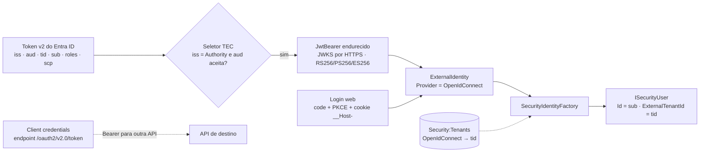

[🏠 TEC.Security](../README.md) › [📚 Documentação](README.md) › 🪪 Provedor Entra ID

# 🪪 Provedor Microsoft Entra ID

> Como proteger APIs e sites com tokens do Microsoft Entra ID, fazer login web e chamar outras APIs com client credentials
> usando o `TEC.Security.OpenIdConnect`. Descreve só o que o código implementa hoje.

## 📑 Sumário

- [🎯 Visão geral](#-visão-geral)
- [🚀 Uso](#-uso)
  - [App registration da API](#app-registration-da-api)
  - [Proteger a API](#proteger-a-api)
  - [Claims do token](#claims-do-token)
  - [Multi-tenant](#multi-tenant)
  - [Várias app registrations](#várias-app-registrations)
  - [Login web](#login-web)
  - [Credencial da aplicação](#credencial-da-aplicação)
  - [Chamar outras APIs](#chamar-outras-apis)
  - [O que não existe](#o-que-não-existe)
- [⚙️ Opções](#️-opções)
- [❌ Erros](#-erros)
- [🛡️ Segurança](#️-segurança)
- [❓ Perguntas frequentes](#-perguntas-frequentes)

---

## 🎯 Visão geral

O Entra ID é um servidor OpenID Connect padrão: o TEC.Security o atende com o provedor agnóstico
[`TEC.Security.OpenIdConnect`](provedor-openid-connect.md). **Não há pacote nem tipo de provedor específico do Entra ID**:
as identidades chegam com `Provider = "OpenIdConnect"` e é essa a chave em `Security:Tenants:*:IdentityProviders`.



| Recurso | Método | Pacote |
|---|---|---|
| API protegida por access token | `AddOpenIdConnectApi` | `TEC.Security.OpenIdConnect` |
| Login web (Authorization Code + PKCE) | `AddOpenIdConnectWebLogin` + `MapTecWebLogin` | `TEC.Security.OpenIdConnect` / `TEC.Security.AspNetCore` |
| Chamar outra API (client credentials) | `AddOpenIdConnectClient` + `AddOpenIdConnectAccessToken` | `TEC.Security.OpenIdConnect` |

---

## 🚀 Uso

### App registration da API

No portal do Entra ID (*App registrations*):

| Item | Valor |
|---|---|
| *Application ID URI* | Opcional (ex.: `api://<client-id-da-api>`); os escopos delegados e o `/.default` usam esse prefixo |
| `requestedAccessTokenVersion` (manifesto) | `2`. Com tokens v1 o `iss` é `https://sts.windows.net/<tenant-id>/` e **não** bate com a `Authority` v2 |
| App roles | Os papéis que a API usa (`roles` no token); atribua a usuários, grupos ou aplicações |
| *Expose an API* | Escopos delegados (ex.: `access_as_user`), que chegam no claim `scp` |

> [!IMPORTANT]
> O emissor aceito é exatamente a `Authority` (com ou sem `/` no fim). Use a versão 2: `https://login.microsoftonline.com/<tenant-id>/v2.0`.

### Proteger a API

```json
{
  "Security": {
    "RequireTenant": true,
    "RolesAsPermissions": false,
    "OpenIdConnect": {
      "Entra": {
        "Authority": "https://login.microsoftonline.com/<tenant-id>/v2.0",
        "Audience": "<client-id-da-api>",
        "MultiTenant": true
      }
    },
    "Tenants": {
      "contoso": { "Name": "Contoso Ltda", "IdentityProviders": { "OpenIdConnect": [ "<tenant-id>" ] } }
    },
    "Permissions": {
      "Roles": { "Gerente": [ "pedidos:ler", "pedidos:cancelar" ] }
    }
  }
}
```

```csharp
using TEC.Security.Abstractions;
using TEC.Security.AspNetCore;
using TEC.Security.AspNetCore.Authorization;
using TEC.Security.DependencyInjection;
using TEC.Security.OpenIdConnect;

builder.Services.AddTecSecurity(builder.Configuration, security => security
    .AddAspNetCore()
    .AddOpenIdConnectApi("Funcionarios", builder.Configuration.GetSection("Security:OpenIdConnect:Entra")));

app.MapGet("/pedidos", (ISecurityUser usuario) => usuario.TenantId)
   .RequireTecAuthorization(permissions: "pedidos:ler");
```

- `Audience` (ou `Audiences`) é o valor que o claim `aud` traz: o *client id* da API em tokens v2 e, quando o token usa o
  *Application ID URI*, o `api://...` correspondente. Informe os dois em `Audiences` se a API recebe ambos.
- O `ISecurityUser.Provider` é `OpenIdConnect` e o `Scheme` é o nome informado (`Funcionarios`).
- Com `RolesAsPermissions` não definido, os app roles também viram permissões ([👤 Identidade e permissões](identidade-e-permissoes.md#permissões-por-papel-no-appsettings)),
  exceto com `MultiTenant = true`, em que o padrão é `false`: mapeie os papéis em `Security:Permissions`
  ([🏢 Tenants](tenants.md#️-segurança)).

### Claims do token

O `TEC.Security.OpenIdConnect` converte o access token validado em `ExternalIdentity` (o primeiro valor de cada tipo vence):

| Claim do token | Vira | Observação |
|---|---|---|
| `sub` | `ISecurityUser.Id` | No Entra ID o `sub` é **específico por aplicação**: o mesmo usuário tem `sub` diferente em outra API. O `oid` não é lido. Sem `sub`, o token é recusado |
| `tid` (ou `tenant_id`, `tenant`, ou o claim de `TenantClaim`) | `ExternalTenantId` | Resolvido no cadastro de tenants pelo provedor `OpenIdConnect` |
| `roles` (ou o claim de `RoleClaimType`) | `Roles` | Valor simples ou array JSON; `role` só é lido se `RoleClaimType` for vazio. Também lê `realm_access`/`resource_access` do Keycloak |
| `scp` (ou `scope`) | `Scopes` | Separados por espaço. O `scp` também decide o `Kind` (abaixo) |
| `preferred_username` (ou `name`, ou o claim de `NameClaimType`) | `Name` | Só exibição; sem nome, usa o `sub` |
| `iss`, `aud`, `exp`, assinatura | Validação | Sempre validados; veja [🛡️ Segurança](seguranca.md#controles-obrigatórios-conferidos-na-subida) |

Não são lidos para a identidade: `oid`, `appid`, `groups` e demais claims. O `azp`, o `appid` e o `idtyp` só entram na
decisão do `Kind`. Os claims originais **não** são copiados para `ISecurityUser.Principal` pelo provedor OpenID Connect.

**Tipo da identidade (`Kind`).** Com `Authority` do Entra ID (`login.microsoftonline.com`, `login.microsoftonline.us`,
`login.partner.microsoftonline.cn`, `login.chinacloudapi.cn` ou `*.ciamlogin.com`), a regra do `scp` liga sozinha: token com
`scp` (permissão delegada) é `User`; sem `scp`, ou com `scp` vazio ou `/` (agente autônomo), é `Application`, o token
app-only de client credentials, com os app roles em `roles`. O claim opcional `idtyp` continua aceito (`idtyp = app` ou
`idtyp = user`); se ele contradisser o `scp`, o token é recusado como ambíguo (401 e log 3201). As regras valem por esquema
e podem ser ajustadas em `Kind` ([🌐 Provedor OpenID Connect](provedor-openid-connect.md#tipo-da-identidade-kind));
`UseEntraIdScpRule = false` desliga a regra do `scp`.

> [!NOTE]
> Antes, um token de aplicação sem o claim opcional `idtyp` chegava como `User` e passava em endpoints com
> `Kinds = TecPrincipalKinds.User`. Agora a ausência de `scp` o classifica como `Application`. Habilitar o `idtyp` no
> manifesto da app registration continua valendo, mas deixou de ser necessário para separar serviços de pessoas.

### Multi-tenant

Com `MultiTenant = true`, a identidade só é aceita se o `tid` (ou, sem claim de tenant, o `iss`) estiver cadastrado e **ativo**
em `Security:Tenants` para o provedor `OpenIdConnect`; senão o token é recusado (401). O log 3201 traz o motivo sem o valor do
`tid` (só o tamanho e um identificador). Sem `MultiTenant`, o tenant é resolvido quando o `tid` está cadastrado; um tenant
inativo continua recusado, e `RequireTenant` recusa a identidade sem tenant.

```json
"Tenants": {
  "contoso":  { "IdentityProviders": { "OpenIdConnect": [ "<tenant-id-da-contoso>" ] } },
  "fabrikam": { "Enabled": false, "IdentityProviders": { "OpenIdConnect": [ "<tenant-id-da-fabrikam>" ] } }
}
```

> [!NOTE]
> O `iss` do token precisa ser igual à `Authority` ou estar em `ValidIssuers` (só em código, e só com `MultiTenant = true`).
> Uma `Authority` com `common` ou `organizations` não funciona, porque o `iss` dos tokens carrega o `tid` de cada tenant.
> Para aceitar tenants com emissores diferentes, liste cada `https://login.microsoftonline.com/<tid>/v2.0` em
> `ValidIssuers`: as chaves vêm do JWKS da `Authority`, que o Entra ID compartilha entre os tenants.

### Várias app registrations

Chame `AddOpenIdConnectApi` uma vez por API, com esquemas diferentes. O seletor percorre os provedores na ordem de registro e
escolhe o primeiro cujo emissor é igual à `Authority` (com `MultiTenant`, também os de `ValidIssuers` ou, sem essa lista,
qualquer emissor) **e** cuja audiência está em
`Audience`/`Audiences`:

```csharp
security
    .AddAspNetCore()
    .AddOpenIdConnectApi("Pedidos", o => { o.Authority = authority; o.Audience = "<client-id-pedidos>"; })
    .AddOpenIdConnectApi("Estoque", o => { o.Authority = authority; o.Audience = "<client-id-estoque>"; });
```

### Login web

```csharp
builder.Services.AddTecSecurity(builder.Configuration, security => security
    .AddAspNetCore()
    .AddOpenIdConnectWebLogin("Web", o =>
    {
        o.Authority = "https://login.microsoftonline.com/<tenant-id>/v2.0";
        o.ClientId = "<client-id-do-site>";
        o.ClientSecretName = "<nome-do-segredo-no-cofre>";   // lido do TEC.Vault; evite ClientSecret na configuração
    }));

app.MapTecWebLogin();   // GET /account/login?returnUrl=/ e POST /account/logout
```

- Cadastre no Entra ID o *Redirect URI* `https://<host>/signin-oidc` (o `CallbackPath` padrão do ASP.NET Core; o TEC.Security
  não o altera).
- Authorization Code + PKCE, `nonce` e `state` obrigatórios, `form_post`, tokens **não** guardados no cookie, escopos `openid`,
  `profile` e `email` (padrão de `Scopes`).
- Cookie `__Host-TEC.Auth` (HttpOnly, Secure, SameSite=Lax), sessão deslizante de 1 hora, duração absoluta de 8 horas.
- O tenant ativo é conferido em toda requisição; tenant e permissões são consultados de novo a cada 5 minutos.
- Chamadas de API sem `Accept: text/html` recebem 401 em vez de redirecionamento.
- Para o ID token trazer `roles`, atribua app roles ao usuário (ou ao grupo) na aplicação do site.
- A identidade do login web é sempre `User`: as regras de `Kind` valem só para a API.
- O segredo de `ClientSecretName` é conferido na subida (se não existir no cofre, a aplicação não sobe) e lido do TEC.Vault de
  novo a cada login, na troca do código, sem ficar guardado nas opções: a rotação no cofre vale sem reiniciar. Não substitua
  os delegates `OnAuthorizationCodeReceived` e `OnPushAuthorization` do esquema, que o provedor usa para isso.

Detalhes do cookie, da revalidação e de `returnUrl`: [🧱 Novo provedor](novo-provedor.md#provedor-de-login-web).

### Credencial da aplicação

O provedor OpenID Connect autentica a aplicação no endpoint de token com **client secret**:

| Opção (`OpenIdConnectClientOptions`) | Descrição |
|---|---|
| `ClientSecretName` | Nome do segredo no TEC.Vault (`ISecretReader`), lido a cada obtenção de token |
| `ClientSecret` | Valor direto (desencorajado em produção) |

Registre o TEC.Vault (`AddTecVault(...)`) quando usar `ClientSecretName`: sem um `ISecretReader` registrado, a aplicação não
sobe. Só o **nome** do segredo vai para a configuração.
Certificado, identidade gerenciada federada e Workload Identity não são implementados ([O que não existe](#o-que-não-existe)).

### Chamar outras APIs

```csharp
using TEC.Security.DependencyInjection;
using TEC.Security.OpenIdConnect;

builder.Services.AddTecSecurity(builder.Configuration, security => security
    .AddOpenIdConnectClient(o =>
    {
        o.TokenEndpoint = "https://login.microsoftonline.com/<tenant-id>/oauth2/v2.0/token";
        o.ClientId = "<client-id-desta-aplicacao>";
        o.ClientSecretName = "<nome-do-segredo-no-cofre>";
    }));

builder.Services.AddHttpClient<EstoqueClient>(c => c.BaseAddress = new Uri("https://estoque.contoso.com/"))
    .AddOpenIdConnectAccessToken(o =>
    {
        o.Scopes.Add("api://<client-id-do-estoque>/.default");   // client credentials no Entra ID: sempre /.default
        o.AllowedHosts.Add("estoque.contoso.com");
    });
```

- Defina `TokenEndpoint`: sem ele o endpoint é inferido como `{Authority}/protocol/openid-connect/token` (padrão do Keycloak),
  que não existe no Entra ID.
- O token é guardado em cache por *client id* + escopos, renovado antes de expirar, e só vai para os hosts de `AllowedHosts`
  ([🔁 Chamadas entre serviços](chamadas-entre-servicos.md)).
- As opções do cliente são validadas na subida: sem `ClientId`, endpoint sem HTTPS, sem segredo ou com `ClientSecretName` sem
  TEC.Vault registrado, a aplicação não sobe. Um cliente por aplicação.
- O `HttpClient` do endpoint de token não segue redirecionamentos (o client secret vai no corpo do POST), e a resposta tem
  tempo limite, teto de 256 KB e `expires_in` conferido.
- O destino vê uma identidade com `roles` (os app roles concedidos à sua aplicação) e sem `scp`; um TEC.Security no destino,
  com `Authority` do Entra ID, a classifica como `Application`.

### O que não existe

Estes recursos eram descritos para o Entra ID, mas **não** estão no código atual:

| Recurso | Situação |
|---|---|
| Pacote `TEC.Security.EntraId`, `AddEntraIdApi`, `AddEntraIdWebLogin`, `AddEntraIdClient`, `AddEntraIdAccessToken` | Não existem; use os métodos `AddOpenIdConnect*` |
| Credenciais `ManagedIdentityFederation`, `WorkloadIdentity`, `Certificate` (client assertion assinada no cofre) | Não existem. `OpenIdConnectM2MAuthType.PrivateKeyJwt` está declarado, mas **não é suportado** (com ele, o `AddOpenIdConnectClient` impede a subida e o construtor do provedor lança `NotSupportedException`), e `CertificateName` não é usado |
| On-Behalf-Of | Não existe |
| `AllowedTenantIds`, `AllowedClientApplications`, `AcceptV1Tokens`, `AllowApplicationTokens` | Não existem (o `azp` e o `idtyp` só servem para decidir o `Kind`, nunca para autorizar) |
| Tenant por emissor (`/{tid}/v2.0`) e validação do emissor da chave de assinatura | Não existem (o emissor é a `Authority` ou um item de `ValidIssuers`, sem conferir o `tid`) |
| Distinguir ID token de access token (`nonce`, `azp`) | Não é feito |
| Configuração por seção para o cliente M2M e para o login web | Só em código (`Action<...Options>`); a API aceita seção (`IConfiguration`) |

---

## ⚙️ Opções

**`OpenIdConnectApiOptions`** (`AddOpenIdConnectApi`; chaves iguais na seção de configuração, exceto `ValidIssuers` e `ValidAlgorithms`)

| Opção | Padrão | Descrição |
|---|---|---|
| `Authority` | — (obrigatória) | Emissor/base do provedor. No Entra ID: `https://login.microsoftonline.com/<tenant-id>/v2.0` |
| `Audience` / `Audiences` | — | Audiências aceitas; ao menos uma |
| `ValidIssuers` | vazio | Emissores extras aceitos, só com `MultiTenant`; sem ele, o seletor os ignora (só em código) |
| `RequireHttpsMetadata` | `true` | `false` só é aceito com `Authority` em loopback; com outro host impede a subida (controle obrigatório) |
| `MultiTenant` | `false` | Exige tenant cadastrado e ativo (`tid`, ou o `iss` sem claim de tenant) |
| `TenantClaim` | `null` | Claim do tenant; quando informado, `tid`, `tenant_id` e `tenant` são ignorados |
| `RoleClaimType` | `roles` | Claim dos papéis |
| `NameClaimType` | `preferred_username` | Claim do nome de exibição |
| `ValidAlgorithms` | RS256, PS256, ES256 | Só assimétricos (só em código) |
| `Kind` | regras padrão, com a regra do `scp` ligada para o Entra ID | Usuário x aplicação (`OpenIdConnectKindOptions`, [detalhes](provedor-openid-connect.md#tipo-da-identidade-kind)); na seção, a subseção `Kind` |

**`OpenIdConnectWebLoginOptions`** (`AddOpenIdConnectWebLogin`)

| Opção | Padrão | Descrição |
|---|---|---|
| `Authority`, `ClientId` | — (obrigatórias) | Provedor e aplicação do site |
| `ClientSecretName` / `ClientSecret` | `null` | Segredo do cofre (preferido; conferido na subida e lido a cada login) ou direto |
| `Scopes` | `profile`, `email` | Acrescentados ao `openid`, que é sempre pedido |
| `RequireHttpsMetadata` | `true` | `false` só é aceito com `Authority` em loopback; com outro host impede a subida |

**`OpenIdConnectClientOptions`** (`AddOpenIdConnectClient`)

| Opção | Padrão | Descrição |
|---|---|---|
| `TokenEndpoint` | `null` | Endpoint de token; sem ele, `{Authority}/protocol/openid-connect/token` |
| `Authority` | vazio | Usada só para inferir o endpoint. Informe `TokenEndpoint` ou `Authority` |
| `ClientId` | — (obrigatório) | Client id da aplicação |
| `ClientSecretName` / `ClientSecret` | `null` | Informe um dos dois; `ClientSecretName` exige o TEC.Vault registrado |
| `Timeout` | 10 s | Tempo limite do pedido de token, do envio até a leitura do corpo (maior que zero, até 5 minutos) |
| `Resilience` | ligado | `SecurityCircuitBreakerOptions` (`FailureRatio` 0,5, `MinimumThroughput` 10, janela e pausa de 30 s) |
| `AuthType`, `CertificateName` | `ClientSecret`, `null` | `PrivateKeyJwt` impede a subida (criando o provedor direto, o construtor lança `NotSupportedException`); `CertificateName` não é usado (veja [O que não existe](#o-que-não-existe)) |

As opções do cliente são validadas na subida (`ValidateOnStart`): valor ausente, fora do limite ou inseguro impede a
aplicação de subir.

---

## ❌ Erros

| Erro | Quando ocorre | O que fazer |
|---|---|---|
| `InvalidOperationException` no registro | `Authority` vazia; sem `Audience`/`Audiences`; regra de `Kind` inválida; no login web, sem `ClientId`; `AddOpenIdConnectClient` chamado duas vezes | Corrija a configuração |
| `InvalidOperationException` na subida (login web) | `ClientSecretName` sem TEC.Vault registrado ou segredo que não existe no cofre | Registre o TEC.Vault e crie o segredo |
| `OptionsValidationException` na subida | `RequireHttpsMetadata = false`, validação desligada ou algoritmo fora de RS\*/PS\*/ES\* ([🧱 Novo provedor](novo-provedor.md#-erros)) | Remova o ajuste |
| `OptionsValidationException` na subida (cliente) | Sem `ClientId`; sem `TokenEndpoint` nem `Authority`; endpoint de token ou `Authority` sem HTTPS; sem segredo; `ClientSecretName` sem TEC.Vault registrado; `Timeout` fora do limite; `PrivateKeyJwt` | Configure o cliente |
| 401 + log 3201 | Assinatura, emissor (≠ `Authority`), audiência ou validade inválidos; token v1 | Confira a versão do token (`requestedAccessTokenVersion: 2`), a `Authority` e a audiência |
| 401 + log 3201 com motivo `claim 'sub' ausente no token` | Token sem `sub` | Use um access token v2 |
| 401 + log 3201 com motivo de tenant | `MultiTenant` com tenant não cadastrado, inativo ou fora do formato | Cadastre o `tid` em `Security:Tenants` |
| 401 + log 3201 com motivo de tipo | `idtyp` contradizendo o `scp` (tipo ambíguo), ou regra do `scp` desligada sem outra regra que reconheça o token (indeterminado) | Confira o token e o `Kind` do esquema ([detalhes](provedor-openid-connect.md#tipo-da-identidade-kind)) |
| 401 + log 3001 | Tenant inativo, `RequireTenant` sem tenant resolvido, excesso de papéis | [👤 Identidade e permissões](identidade-e-permissoes.md#-erros) |
| 403 | Falta permissão, papel, escopo, tipo ou esquema | Veja o motivo no log 3203 |
| `SecurityTokenAcquisitionException` ao obter token | Segredo não encontrado no cofre; o endpoint de token recusou o pedido ou respondeu 3xx (mensagem `HTTP <status>`, sem o corpo); tempo limite; corpo acima de 256 KB; `expires_in` inválido; circuito aberto (`SecurityCircuitOpenException` em `InnerException`) | Veja o log 3120 e aguarde a pausa do circuito (30 s) ([🔁 Chamadas entre serviços](chamadas-entre-servicos.md#resiliência-circuit-breaker)) |
| Login web: 401 + log 3207 | Falha remota (ex.: `invalid_client` na troca do código por segredo ausente ou errado); cofre fora do ar na troca do código | Confira `ClientSecretName`/`ClientSecret`, o cofre e o *Redirect URI* |

---

## 🛡️ Segurança

> [!CAUTION]
> O provedor OpenID Connect não diferencia ID token de access token. Use uma audiência exclusiva da API (o *client id* da API,
> não o do site) e nunca aceite como `Audience` o client id de uma aplicação que também emite ID tokens para os usuários.

> [!WARNING]
> O `sub` do Entra ID muda de uma aplicação para outra. Use o `ISecurityUser.Id` como chave de auditoria **dentro** desta
> API, mas não o cruze com o `sub` de outro sistema.

- Chaves só do JWKS da `Authority`, por HTTPS; algoritmos só RS\*/PS\*/ES\*; tolerância de relógio de 30 s.
- Em ambientes multi-tenant, o administrador de cada tenant atribui os app roles aos próprios usuários: com
  `MultiTenant = true`, `RolesAsPermissions` fica em `false` por padrão; mantenha assim e use permissões por tenant
  ([🏢 Tenants](tenants.md#️-segurança)).
- Prefira `ClientSecretName` a `ClientSecret`: o valor fica no TEC.Vault, e a rotação do segredo é acompanhada pela leitura a
  cada obtenção de token (cliente) e a cada login (login web).
- Tokens de aplicação sem `scp` nunca passam como pessoa: `Kinds = TecPrincipalKinds.User` separa pessoas de serviços sem
  depender do claim opcional `idtyp`.
- O cadastro de tenants decide quem entra, não o que cada um vê: filtre os dados pelo `TenantId`.

---

## ❓ Perguntas frequentes

<details>
<summary>Preciso de um pacote específico para o Entra ID?</summary>

Não: o `TEC.Security.OpenIdConnect` atende o Entra ID com tokens v2. Veja [O que não existe](#o-que-não-existe) para o que o
Entra ID oferece e o componente não usa.

</details>

<details>
<summary>Meu token do Entra ID é recusado com 401.</summary>

Compare o `iss` do token com a `Authority` (token v2: `https://login.microsoftonline.com/<tenant-id>/v2.0`) e o `aud` com
`Audience`/`Audiences`. O log 3201 traz o tipo da falha ou o motivo da recusa (tenant, tipo da identidade ambíguo), nunca
valores do token; decodifique o token (sem enviá-lo a terceiros) para conferir.

</details>

<details>
<summary>Como aceito os usuários de vários tenants do Entra ID?</summary>

Cada tenant tem um `iss` próprio. Duas opções: registre um esquema por tenant (`AddOpenIdConnectApi` com a `Authority` de
cada um) ou use um esquema com `MultiTenant = true` e os emissores dos outros tenants em `ValidIssuers`. Nos dois casos,
vincule o `tid` de cada um ao tenant da aplicação em `Security:Tenants`.

</details>

---
⬅️ [🌐 Provedor OpenID Connect](provedor-openid-connect.md) · [📚 Índice](README.md) · [🔁 Chamadas entre serviços](chamadas-entre-servicos.md) ➡️
