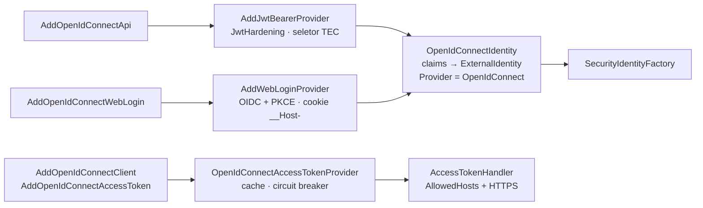

[🏠 TEC.Security](../README.md) › [📚 Documentação](README.md) › 🌐 Provedor OpenID Connect

# 🌐 Provedor OpenID Connect

> O pacote `TEC.Security.OpenIdConnect` protege APIs, faz login web e obtém tokens de serviço contra qualquer servidor
> OpenID Connect / OAuth 2.0 (Keycloak, Auth0, Okta, Microsoft Entra ID, Google, Cognito), com a validação endurecida e a
> normalização de identidade do TEC.Security.

## 📑 Sumário

- [🎯 Visão geral](#-visão-geral)
- [🚀 Uso](#-uso)
  - [Proteger APIs com tokens Bearer](#proteger-apis-com-tokens-bearer)
  - [Mapeamento de claims](#mapeamento-de-claims)
  - [Multi-tenant](#multi-tenant)
  - [Login web](#login-web)
  - [Chamadas entre serviços (client credentials)](#chamadas-entre-serviços-client-credentials)
- [⚙️ Opções](#️-opções)
- [❌ Erros](#-erros)
- [🛡️ Segurança](#️-segurança)
- [❓ Perguntas frequentes](#-perguntas-frequentes)

---

## 🎯 Visão geral



| Cenário | Método | Resultado |
|---|---|---|
| API protegida por access token | `AddOpenIdConnectApi` | Esquema JWT endurecido com a identidade normalizada |
| Site com login de usuários | `AddOpenIdConnectWebLogin` (+ `MapTecWebLogin`) | Authorization Code + PKCE e cookie de sessão revalidado |
| Chamar outra API | `AddOpenIdConnectClient` + `AddOpenIdConnectAccessToken` | `Authorization: Bearer` com token de client credentials, só para os hosts autorizados |

O tipo de provedor das identidades é sempre `OpenIdConnect`: é a chave em `Security:Tenants:*:IdentityProviders`
([🏢 Tenants](tenants.md)) e o valor de `ISecurityUser.Provider`. Para o Entra ID, veja [🪪 Provedor Entra ID](provedor-entra-id.md).

---

## 🚀 Uso

### Proteger APIs com tokens Bearer

```csharp
using TEC.Security.AspNetCore;
using TEC.Security.DependencyInjection;
using TEC.Security.OpenIdConnect;

builder.Services.AddTecSecurity(builder.Configuration, security => security
    .AddAspNetCore()
    .AddOpenIdConnectApi("Keycloak", options =>
    {
        options.Authority = "https://auth.empresa.com/realms/corporativo";
        options.Audience = "api-pedidos";
    }));
```

Ou lendo uma seção do `appsettings.json` (`Authority`, `Audience`, `Audiences`, `RequireHttpsMetadata`, `MultiTenant`,
`TenantClaim`, `RoleClaimType`, `NameClaimType`):

```json
{
  "Security": {
    "OpenIdConnect": {
      "Api": {
        "Authority": "https://auth.empresa.com/realms/corporativo",
        "Audience": "api-pedidos"
      }
    }
  }
}
```

```csharp
security.AddAspNetCore()
        .AddOpenIdConnectApi("Keycloak", builder.Configuration.GetSection("Security:OpenIdConnect:Api"));

app.MapGet("/pedidos", () => Results.Ok("Liberado"))
   .RequireTecAuthorization(permissions: "pedidos:ler");
```

O `iss` do token precisa ser igual à `Authority` e o `aud` precisa estar em `Audience`/`Audiences`; as chaves vêm do JWKS da
`Authority` (descoberta automática, por HTTPS). Mais de uma API: chame o método uma vez por esquema.

### Mapeamento de claims

| Claim do token | Vira | Observação |
|---|---|---|
| `sub` | `Id` | Obrigatório |
| `tid`, `tenant_id`, `tenant` (ou o claim de `TenantClaim`) | `ExternalTenantId` | Resolvido no cadastro de tenants |
| `roles`, `role` (ou `RoleClaimType`) | `Roles` | Valor simples ou array JSON |
| `realm_access`, `resource_access` | `Roles` | Padrão do Keycloak: lê os `roles` aninhados |
| `scp`, `scope` | `Scopes` | Separados por espaço |
| `preferred_username`, `name` (ou `NameClaimType`) | `Name` | Sem nome, usa o `sub` |

```json
{ "roles": ["admin", "financeiro"] }
{ "realm_access": { "roles": ["admin"] } }
{ "resource_access": { "client-app": { "roles": ["editor"] } } }
```

O tipo da identidade é inferido: `Application` quando não há papéis, há `scope`/`scp` e não há `email` nem
`preferred_username`; senão `User`. Os claims originais, o `azp` e o `ClientId` não são copiados para o `ISecurityUser`.

### Multi-tenant

Com `MultiTenant = true`, o token só é aceito se o tenant (claim de tenant ou, na falta dele, o `iss`) estiver cadastrado e
ativo no `ITenantRegistry` para o provedor `OpenIdConnect`. O emissor continua precisando ser igual à `Authority`.

```json
{
  "Security": {
    "RequireTenant": true,
    "Tenants": {
      "contoso": { "IdentityProviders": { "OpenIdConnect": [ "https://auth.empresa.com/realms/corporativo" ] } }
    }
  }
}
```

### Login web

```csharp
builder.Services.AddTecSecurity(builder.Configuration, security => security
    .AddAspNetCore()
    .AddOpenIdConnectWebLogin("Web", options =>
    {
        options.Authority = "https://auth.empresa.com/realms/corporativo";
        options.ClientId = "portal-web";
        options.ClientSecretName = "portal-web-secret";   // lido do TEC.Vault na criação das opções
        // Scopes: padrão profile e email (openid é sempre pedido); acrescente os que o seu IdP exige para emitir papéis
    }));

app.MapTecWebLogin();   // GET /account/login?returnUrl=/ e POST /account/logout
```

Authorization Code + PKCE, `nonce` e `state`, `form_post`, cookie `__Host-TEC.Auth`, tokens fora do cookie, tenant conferido
a cada requisição e permissões revalidadas a cada 5 minutos (sessão de até 8 horas). Detalhes em
[🧱 Novo provedor](novo-provedor.md#provedor-de-login-web). Só um login web por aplicação.

### Chamadas entre serviços (client credentials)

```csharp
using TEC.Security.Abstractions;
using TEC.Security.OpenIdConnect;

builder.Services.AddTecSecurity(builder.Configuration, security => security
    .AddOpenIdConnectClient(options =>
    {
        options.Authority = "https://auth.empresa.com/realms/corporativo";
        options.ClientId = "servico-faturamento";
        options.ClientSecretName = "segredo-faturamento";   // lido do TEC.Vault a cada obtenção de token
    }));

// Limitação atual: o AddOpenIdConnectClient registra o IAccessTokenProvider de um jeito que o container não resolve
builder.Services.AddSingleton<IAccessTokenProvider>(sp => sp.GetRequiredService<OpenIdConnectAccessTokenProvider>());

builder.Services.AddHttpClient("EstoqueClient", client => client.BaseAddress = new Uri("https://estoque.empresa.com/"))
    .AddOpenIdConnectAccessToken(options =>
    {
        options.Scopes.Add("estoque.consultar");
        options.AllowedHosts.Add("estoque.empresa.com");   // o token só vai para este host, por HTTPS
    });
```

O endpoint de token é `TokenEndpoint` ou, sem ele, `{Authority}/protocol/openid-connect/token` (Keycloak). Para outros
provedores informe `TokenEndpoint`. Cache por *client id* + escopos, renovação antes de expirar e circuit breaker:
[🔁 Chamadas entre serviços](chamadas-entre-servicos.md).

---

## ⚙️ Opções

**Métodos** (`TEC.Security.OpenIdConnect.OpenIdConnectExtensions`)

| Método | Descrição |
|---|---|
| `AddOpenIdConnectApi(string scheme, IConfiguration section)` | API protegida, opções lidas de uma seção |
| `AddOpenIdConnectApi(string scheme, Action<OpenIdConnectApiOptions> configure)` | API protegida, opções em código |
| `AddOpenIdConnectWebLogin(string scheme, Action<OpenIdConnectWebLoginOptions> configure)` | Login web (um por aplicação) |
| `AddOpenIdConnectClient(Action<OpenIdConnectClientOptions> configure)` | Provedor de tokens de serviço (client credentials) |
| `AddOpenIdConnectAccessToken(this IHttpClientBuilder, Action<AccessTokenHandlerOptions> configure)` | Anexa o token aos hosts autorizados |

**`OpenIdConnectApiOptions`**

| Opção | Padrão | Descrição |
|---|---|---|
| `Authority` | — (obrigatória) | URL base do provedor; também é o único emissor aceito |
| `Audience` / `Audiences` | — | Audiências aceitas; ao menos uma |
| `RequireHttpsMetadata` | `true` | Só `true` é aceito: `false` impede a subida |
| `MultiTenant` | `false` | Exige tenant cadastrado e ativo |
| `TenantClaim` | `null` | Claim do tenant (senão `tid`, `tenant_id`, `tenant`) |
| `RoleClaimType` | `roles` | Claim dos papéis |
| `NameClaimType` | `preferred_username` | Claim do nome de exibição |
| `ValidAlgorithms` | RS256, PS256, ES256 | Só assimétricos; só em código |

**`OpenIdConnectWebLoginOptions`**: `Authority` e `ClientId` (obrigatórios), `ClientSecretName` (segredo no TEC.Vault) ou
`ClientSecret`, `Scopes` (padrão `profile` e `email`; `openid` é sempre pedido), `RequireHttpsMetadata` (`true`).

**`OpenIdConnectClientOptions`**

| Opção | Padrão | Descrição |
|---|---|---|
| `Authority` | vazio | Base para inferir o endpoint de token |
| `TokenEndpoint` | `null` | Endpoint de token direto |
| `ClientId` | — (obrigatório) | Client id da aplicação |
| `ClientSecretName` / `ClientSecret` | `null` | Segredo no TEC.Vault (preferido) ou direto; um dos dois é obrigatório |
| `Timeout` | 10 s | Tempo limite do pedido ao endpoint de token |
| `Resilience` | ligado | `SecurityCircuitBreakerOptions` |
| `AuthType`, `CertificateName` | `ClientSecret`, `null` | `PrivateKeyJwt` e o certificado estão declarados, mas sem implementação: não use |

---

## ❌ Erros

| Erro | Quando ocorre | O que fazer |
|---|---|---|
| `InvalidOperationException` no registro | `Authority` vazia, sem audiência ou, no login web, sem `ClientId` | Informe os valores |
| `OptionsValidationException` na subida | Controle obrigatório desligado (`RequireHttpsMetadata = false`, algoritmo fora da lista...) | Remova o ajuste ([🧱 Novo provedor](novo-provedor.md#-erros)) |
| 401 + log 3201 | Token inválido; sem `sub`; `MultiTenant` sem tenant cadastrado | Veja o motivo no log |
| `InvalidOperationException` ao obter token | Sem `ClientId`, sem endpoint, sem segredo, `ISecretReader` ausente, segredo não encontrado, ou o endpoint de token recusou (mensagem com `HTTP <status>`) | Configure o cliente e o TEC.Vault |
| `SecurityCircuitOpenException` | Circuito aberto após falhas repetidas do endpoint de token | Aguarde a pausa; verifique o IdP |

---

## 🛡️ Segurança

> [!CAUTION]
> O provedor não diferencia ID token de access token. Use audiência exclusiva da API.

- Algoritmos só RS\*/PS\*/ES\*, emissor exato, tolerância de relógio de 30 s e chaves só do JWKS da `Authority`.
- Segredo do cliente no TEC.Vault (só o nome na configuração); a mensagem da exceção de falha do endpoint de token inclui o
  corpo da resposta do IdP: não a registre em log aberto.
- Em APIs multi-tenant use `RolesAsPermissions: false` e permissões por tenant ([🏢 Tenants](tenants.md#️-segurança)).

---

## ❓ Perguntas frequentes

<details>
<summary>Meus papéis vêm em outro claim (ex.: <code>cognito:groups</code>).</summary>

Informe o nome em `RoleClaimType`. Os claims `roles`, `role` e os objetos do Keycloak já são lidos sem configuração.

</details>

<details>
<summary>Como uso o Microsoft Entra ID?</summary>

Com `Authority = https://login.microsoftonline.com/<tenant-id>/v2.0` e tokens v2. Passo a passo e limites:
[🪪 Provedor Entra ID](provedor-entra-id.md).

</details>

---
⬅️ [🏢 Tenants](tenants.md) · [📚 Índice](README.md) · [🪪 Provedor Entra ID](provedor-entra-id.md) ➡️
