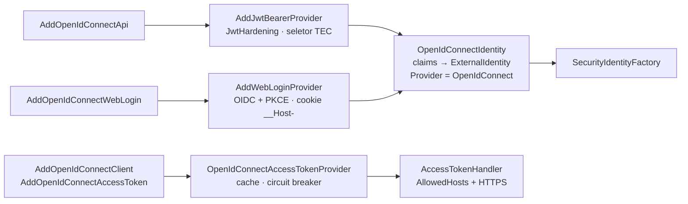

[🏠 TEC.Security](../README.md) › [📚 Documentação](README.md) › 🌐 Provedor OpenID Connect

# 🌐 Provedor OpenID Connect

> O pacote `TEC.Security.OpenIdConnect` protege APIs, faz login web e obtém tokens de serviço contra qualquer servidor
> OpenID Connect / OAuth 2.0 (Keycloak, Auth0, Okta, Microsoft Entra ID, Google, Cognito), com a validação endurecida e a
> normalização de identidade do TEC.Security.

## 📑 Sumário

- [🎯 Visão geral](#-visão-geral)
- [🚀 Uso](#-uso)
  - [Proteger APIs com tokens Bearer](#proteger-apis-com-tokens-bearer)
  - [Mapeamento de claims](#mapeamento-de-claims)
  - [Tipo da identidade (Kind)](#tipo-da-identidade-kind)
  - [Multi-tenant](#multi-tenant)
  - [Login web](#login-web)
  - [Chamadas entre serviços (client credentials)](#chamadas-entre-serviços-client-credentials)
- [⚙️ Opções](#️-opções)
- [❌ Erros](#-erros)
- [🛡️ Segurança](#️-segurança)
- [❓ Perguntas frequentes](#-perguntas-frequentes)

---

## 🎯 Visão geral



| Cenário | Método | Resultado |
|---|---|---|
| API protegida por access token | `AddOpenIdConnectApi` | Esquema JWT endurecido com a identidade normalizada |
| Site com login de usuários | `AddOpenIdConnectWebLogin` (+ `MapTecWebLogin`) | Authorization Code + PKCE e cookie de sessão revalidado |
| Chamar outra API | `AddOpenIdConnectClient` + `AddOpenIdConnectAccessToken` | `Authorization: Bearer` com token de client credentials, só para os hosts autorizados |

O tipo de provedor das identidades é sempre `OpenIdConnect`: é a chave em `Security:Tenants:*:IdentityProviders`
([🏢 Tenants](tenants.md)) e o valor de `ISecurityUser.Provider`. Para o Entra ID, veja [🪪 Provedor Entra ID](provedor-entra-id.md).

---

## 🚀 Uso

### Proteger APIs com tokens Bearer

```csharp
using TEC.Security.AspNetCore;
using TEC.Security.DependencyInjection;
using TEC.Security.OpenIdConnect;

builder.Services.AddTecSecurity(builder.Configuration, security => security
    .AddAspNetCore()
    .AddOpenIdConnectApi("Keycloak", options =>
    {
        options.Authority = "https://auth.empresa.com/realms/corporativo";
        options.Audience = "api-pedidos";
    }));
```

Ou lendo uma seção do `appsettings.json` (`Authority`, `Audience`, `Audiences`, `RequireHttpsMetadata`, `MultiTenant`,
`TenantClaim`, `RoleClaimType`, `NameClaimType` e a subseção `Kind`):

```json
{
  "Security": {
    "OpenIdConnect": {
      "Api": {
        "Authority": "https://auth.empresa.com/realms/corporativo",
        "Audience": "api-pedidos"
      }
    }
  }
}
```

```csharp
security.AddAspNetCore()
        .AddOpenIdConnectApi("Keycloak", builder.Configuration.GetSection("Security:OpenIdConnect:Api"));

app.MapGet("/pedidos", () => Results.Ok("Liberado"))
   .RequireTecAuthorization(permissions: "pedidos:ler");
```

O `iss` do token precisa ser igual à `Authority` e o `aud` precisa estar em `Audience`/`Audiences`; as chaves vêm do JWKS da
`Authority` (descoberta automática, por HTTPS). Mais de uma API: chame o método uma vez por esquema.

### Mapeamento de claims

| Claim do token | Vira | Observação |
|---|---|---|
| `sub` | `Id` | Obrigatório |
| `tid`, `tenant_id`, `tenant` (ou, se informado, só o claim de `TenantClaim`) | `ExternalTenantId` | Resolvido no cadastro de tenants; sem claim de tenant, o `iss` é a chave de busca. Valores divergentes entre os claims recusam o token |
| `roles` (ou o claim de `RoleClaimType`) | `Roles` | Valor simples ou array JSON. `role` só é lido se `RoleClaimType` for vazio |
| `realm_access` | `Roles` | Padrão do Keycloak: todos os `roles` de realm do token, de qualquer client |
| `resource_access` | `Roles` | Padrão do Keycloak: só os `roles` dos clients informados em `Audience`/`Audiences`, com o nome comparado exatamente (diferencia maiúsculas). No login web, só os do `ClientId`. Sem client alvo, nenhum papel de client entra |
| `scp`, `scope` | `Scopes` | Separados por espaço |
| `preferred_username`, `name` (ou `NameClaimType`) | `Name` | Sem nome, usa o `sub` |

```json
{ "roles": ["admin", "financeiro"] }
{ "realm_access": { "roles": ["admin"] } }
{ "resource_access": { "client-app": { "roles": ["editor"] } } }
```

Os claims originais, o `azp` e o `ClientId` não são copiados para o `ISecurityUser`. No login web, o ID token do Keycloak só
traz `resource_access` se o mapper de client roles estiver marcado para o ID token, e só os papéis do `ClientId` entram.

### Tipo da identidade (Kind)

O provedor decide se o access token é de uma pessoa (`User`) ou de uma aplicação (`Application`) pelas regras do esquema, em
`OpenIdConnectApiOptions.Kind` (`OpenIdConnectKindOptions`). A decisão pesa: `[TecAuthorize(Kinds = ...)]` separa pessoas de
serviços, os escopos só valem para `User` e o `IPermissionStore` recebe o tipo.

| Regra | Padrão | Indica |
|---|---|---|
| `ApplicationClaims` | `idtyp=app` (claim opcional do Entra ID) e `gty=client-credentials` (Auth0) | Aplicação |
| `UserClaims` | `idtyp=user`, `sid=*` (sessão do usuário no IdP) e `auth_time=*` (instante do login) | Usuário |
| `ApplicationWhenSubjectIsClient` | `true` | Aplicação quando o `sub` é igual a `azp`, `client_id`, `clientId`, `cid` ou `appid`: o cliente pediu o token em nome próprio (RFC 9068, Okta, Cognito) |
| `UseEntraIdScpRule` | `null` (ligada quando a `Authority` é do Entra ID) | Usuário com `scp`; aplicação sem `scp` ou com `scp` vazio ou `/` |
| `Unresolved` | `Reject` | O que fazer quando nenhuma regra reconhece o token: `Reject`, `User` ou `Application` |

As regras de claim usam o formato `claim=valor`, com comparação exata (diferencia maiúsculas): `claim=*` aceita qualquer
valor e um valor terminado em `*` é prefixo (ex.: `client_id=*`, `sub=svc-*`). A regra do `scp` liga sozinha para as
`Authority` em `login.microsoftonline.com`, `login.microsoftonline.us`, `login.partner.microsoftonline.cn`,
`login.chinacloudapi.cn` e `*.ciamlogin.com`; `UseEntraIdScpRule = true` ou `false` fixa o comportamento para qualquer IdP.

A decisão segue três passos:

1. Sinal de aplicação e sinal de usuário no mesmo token: o token é recusado (tipo ambíguo).
2. Sinais de um tipo só: esse é o tipo.
3. Nenhum sinal: vale `Unresolved`. Com o padrão `Reject`, o token é recusado (401 e log 3201 com o motivo
   `tipo da identidade indeterminado`).

O padrão recusa em vez de supor um tipo porque qualquer suposição abre acesso indevido: supor `User` deixaria um token de
aplicação não reconhecido passar em endpoints com `Kinds = User` e com escopos; supor `Application` deixaria uma pessoa
passar em endpoints com `Kinds = Application`. A recusa só nega, até a regra do seu IdP ser configurada.

O `preferred_username` não decide o tipo, porque o usuário (ou o administrador do tenant) consegue editá-lo; a regra antiga
que tratava o prefixo `service-account-` do Keycloak como aplicação foi removida. Regras sobre claims editáveis
(`preferred_username`, `name`, `given_name`, `family_name`, `middle_name`, `nickname`, `email`, `upn`, `unique_name`) ou
reservados (`tec_*`) são recusadas no registro com `InvalidOperationException`, assim como regras fora do formato.

| IdP | O que configurar |
|---|---|
| Keycloak, usuários | Em geral nada: os tokens de usuário trazem `sid` (sessão no IdP) |
| Keycloak, conta de serviço | `ApplicationClaims` com `client_id=*` (`clientId=*` em versões antigas), claim que o mapper da conta de serviço emite. Se o token da conta de serviço do seu Keycloak também trouxer `sid` ou `auth_time`, tire esses itens de `UserClaims` |
| Auth0 | `Unresolved = User`: todo token de client credentials do Auth0 traz `gty = client-credentials` |
| Okta, Cognito | Client credentials reconhecido pelo `sub` igual a `cid` ou `client_id`. Usuário do Okta sem `auth_time` no token: `UserClaims` com `uid=*` |
| Microsoft Entra ID | Nada: a regra do `scp` é automática e o claim opcional `idtyp` continua aceito ([🪪 Provedor Entra ID](provedor-entra-id.md#claims-do-token)) |

Antes de fixar as regras, confira um token real decodificado, sem enviá-lo a terceiros.

```json
{
  "Security": {
    "OpenIdConnect": {
      "Api": {
        "Authority": "https://auth.empresa.com/realms/corporativo",
        "Audience": "api-pedidos",
        "Kind": {
          "ApplicationClaims": [ "idtyp=app", "gty=client-credentials", "client_id=*" ],
          "Unresolved": "Reject"
        }
      }
    }
  }
}
```

Na seção de configuração, `Kind:ApplicationClaims` e `Kind:UserClaims` **substituem** as listas padrão (repita os itens que
quiser manter, como no exemplo); em código, `options.Kind.ApplicationClaims.Add("client_id=*")` acrescenta. `Kind:Unresolved`
aceita `Reject`, `User` ou `Application` pelo nome. Número, nome desconhecido ou booleano inválido em
`Kind:ApplicationWhenSubjectIsClient` e `Kind:UseEntraIdScpRule` impedem a aplicação de subir.

O login web não usa essas regras: o ID token de um login interativo é sempre de uma pessoa (`User`).

### Multi-tenant

Com `MultiTenant = true`, o token só é aceito se o tenant (claim de tenant ou, na falta dele, o `iss`) estiver cadastrado e
ativo no `ITenantRegistry` para o provedor `OpenIdConnect`. O emissor precisa ser igual à `Authority` ou estar em
`ValidIssuers` (só em código; sem `MultiTenant`, o seletor ignora os emissores extras). Os emissores extras usam as chaves do
JWKS da `Authority`: só servem para IdPs que assinam os tokens de vários emissores com as mesmas chaves, como o Entra ID. O
`tid` do token não é conferido contra o emissor. Um realm do Keycloak por tenant tem chaves próprias e exige um esquema por
realm.

Com `MultiTenant`, um tenant fora do formato (vazio, com espaço ou caractere de controle) também é recusado, com motivo
próprio. O motivo vai para o log 3201 sem o valor do claim, que vem do token: só o tamanho e um identificador (HMAC com
chave do processo, via `SensitiveDataMasker.DescribeUntrusted`).

O indicador multi-tenant viaja na identidade normalizada (claim `tec_multi_tenant`). Assim, o
`SecurityIdentityFactory.RevalidateAsync` (a revalidação periódica das sessões de login web) mantém `RolesAsPermissions` em
`false` quando ele não está definido, como na criação da identidade; antes, a revalidação perdia o indicador e os papéis
voltavam a valer como permissões.

Sem `MultiTenant`, o tenant também é resolvido pelo cadastro quando o `tid` (ou o `iss`) está cadastrado e ativo; sem
cadastro e sem `RequireTenant`, a identidade autentica sem tenant.

```json
{
  "Security": {
    "RequireTenant": true,
    "Tenants": {
      "contoso": { "IdentityProviders": { "OpenIdConnect": [ "https://auth.empresa.com/realms/corporativo" ] } }
    }
  }
}
```

### Login web

```csharp
builder.Services.AddTecSecurity(builder.Configuration, security => security
    .AddAspNetCore()
    .AddOpenIdConnectWebLogin("Web", options =>
    {
        options.Authority = "https://auth.empresa.com/realms/corporativo";
        options.ClientId = "portal-web";
        options.ClientSecretName = "portal-web-secret";   // conferido na subida e lido do TEC.Vault a cada login
        // Scopes: padrão profile e email (openid é sempre pedido); acrescente os que o seu IdP exige para emitir papéis
    }));

app.MapTecWebLogin();   // GET /account/login?returnUrl=/ e POST /account/logout
```

Authorization Code + PKCE, `nonce` e `state`, `form_post`, cookie `__Host-TEC.Auth`, tokens fora do cookie, tenant conferido
a cada requisição e permissões revalidadas a cada 5 minutos (sessão de até 8 horas). Detalhes em
[🧱 Novo provedor](novo-provedor.md#provedor-de-login-web). Só um login web por aplicação.

- A identidade do login web é sempre `User` e, em `resource_access`, só os papéis do `ClientId` entram.
- Com `ClientSecretName`, o segredo é conferido na subida (se não existir no cofre, a aplicação não sobe) e lido do TEC.Vault
  de novo a cada login: na troca do código (`OnAuthorizationCodeReceived`) e no pedido de autorização enviado por PAR
  (`OnPushAuthorization`, que o ASP.NET Core usa quando o IdP anuncia o endpoint, como o Keycloak). O valor não fica em
  `OpenIdConnectOptions.ClientSecret`, então a rotação no cofre vale sem reiniciar. Não substitua esses dois delegates.
  Com o cofre fora do ar, o login falha: na troca do código, com 401 e log 3207; no pedido por PAR, a exceção do desafio
  sobe para a aplicação (`InvalidOperationException`).
- Os delegates de evento continuam rodando, mas não aprovam sozinhos: `Success()` ou um principal trocado em
  `OnMessageReceived`, `OnAuthorizationCodeReceived`, `OnTokenResponseReceived`, `OnAuthenticationFailed`,
  `OnTokenValidated` ou `OnTicketReceived` recusam o login, e gravar no cookie uma identidade que não veio do
  `SecurityIdentityFactory` lança `InvalidOperationException` ([🛡️ Segurança](seguranca.md),
  [🧱 Novo provedor](novo-provedor.md#provedor-de-login-web)).

### Chamadas entre serviços (client credentials)

```csharp
using TEC.Security.DependencyInjection;
using TEC.Security.OpenIdConnect;

builder.Services.AddTecSecurity(builder.Configuration, security => security
    .AddOpenIdConnectClient(options =>
    {
        options.Authority = "https://auth.empresa.com/realms/corporativo";
        options.ClientId = "servico-faturamento";
        options.ClientSecretName = "segredo-faturamento";   // lido do TEC.Vault a cada obtenção de token
    }));

// O AddOpenIdConnectClient já registra OpenIdConnectAccessTokenProvider e IAccessTokenProvider (Singleton)

builder.Services.AddHttpClient("EstoqueClient", client => client.BaseAddress = new Uri("https://estoque.empresa.com/"))
    .AddOpenIdConnectAccessToken(options =>
    {
        options.Scopes.Add("estoque.consultar");
        options.AllowedHosts.Add("estoque.empresa.com");   // o token só vai para este host, por HTTPS
    });
```

O endpoint de token é `TokenEndpoint` ou, sem ele, `{Authority}/protocol/openid-connect/token` (Keycloak). Para outros
provedores informe `TokenEndpoint`. Cache por *client id* + escopos, renovação antes de expirar e circuit breaker:
[🔁 Chamadas entre serviços](chamadas-entre-servicos.md).

- Um cliente por aplicação: chamar `AddOpenIdConnectClient` de novo lança `InvalidOperationException`.
- As opções são validadas na subida (`ValidateOnStart`): configuração errada ou insegura impede a aplicação de subir com
  `OptionsValidationException` (ver [Erros](#-erros)).
- O `HttpClient` do endpoint de token não segue redirecionamentos nem guarda cookies: o client secret vai no corpo do POST, e
  um 307/308 o reenviaria a outro destino. Resposta 3xx é falha.
- A resposta tem tempo limite (`Timeout`, do envio até a leitura do corpo), teto de 256 KB e validação do `expires_in`
  ([🔁 Chamadas entre serviços](chamadas-entre-servicos.md#️-segurança)).

---

## ⚙️ Opções

**Métodos** (`TEC.Security.OpenIdConnect.OpenIdConnectExtensions`)

| Método | Descrição |
|---|---|
| `AddOpenIdConnectApi(string scheme, IConfiguration section)` | API protegida, opções lidas de uma seção |
| `AddOpenIdConnectApi(string scheme, Action<OpenIdConnectApiOptions> configure)` | API protegida, opções em código |
| `AddOpenIdConnectWebLogin(string scheme, Action<OpenIdConnectWebLoginOptions> configure)` | Login web (um por aplicação) |
| `AddOpenIdConnectClient(Action<OpenIdConnectClientOptions> configure)` | Provedor de tokens de serviço (client credentials) |
| `AddOpenIdConnectAccessToken(this IHttpClientBuilder, Action<AccessTokenHandlerOptions> configure)` | Anexa o token aos hosts autorizados |

**`OpenIdConnectApiOptions`**

| Opção | Padrão | Descrição |
|---|---|---|
| `Authority` | — (obrigatória) | URL base do provedor; também é o único emissor aceito |
| `Audience` / `Audiences` | — | Audiências aceitas; ao menos uma |
| `ValidIssuers` | vazio | Emissores extras aceitos, só com `MultiTenant` (sem ele, o seletor os ignora); usam o JWKS da `Authority`. Só em código |
| `RequireHttpsMetadata` | `true` | `false` só é aceito com `Authority` em loopback (`localhost`, `127.0.0.1`); com outro host impede a subida |
| `MultiTenant` | `false` | Exige tenant cadastrado e ativo. Também deixa `RolesAsPermissions` em `false` quando não definido |
| `TenantClaim` | `null` | Claim do tenant; quando informado, os outros (`tid`, `tenant_id`, `tenant`) são ignorados |
| `RoleClaimType` | `roles` | Claim dos papéis |
| `NameClaimType` | `preferred_username` | Claim do nome de exibição |
| `ValidAlgorithms` | RS256, PS256, ES256 | Só assimétricos; só em código |
| `Kind` | abaixo | Regras de usuário x aplicação (`OpenIdConnectKindOptions`); na seção, a subseção `Kind` |

**`OpenIdConnectKindOptions`** (`OpenIdConnectApiOptions.Kind`, ver [Tipo da identidade](#tipo-da-identidade-kind))

| Opção | Padrão | Descrição |
|---|---|---|
| `ApplicationClaims` | `idtyp=app`, `gty=client-credentials` | Regras `claim=valor` que indicam aplicação (`*` = qualquer valor; terminado em `*` = prefixo) |
| `UserClaims` | `idtyp=user`, `sid=*`, `auth_time=*` | Regras `claim=valor` que indicam usuário |
| `ApplicationWhenSubjectIsClient` | `true` | `sub` igual a `azp`, `client_id`, `clientId`, `cid` ou `appid` indica aplicação |
| `UseEntraIdScpRule` | `null` | Regra do `scp` do Entra ID; `null` liga só para `Authority` do Entra ID |
| `Unresolved` | `Reject` | Token sem nenhum sinal: `Reject` (401), `User` ou `Application` |

**`OpenIdConnectWebLoginOptions`**: `Authority` e `ClientId` (obrigatórios; o `ClientId` também é o único client lido de
`resource_access`), `ClientSecretName` (segredo no TEC.Vault, conferido na subida e lido a cada login) ou `ClientSecret`,
`Scopes` (padrão `profile` e `email`; `openid` é sempre pedido), `RequireHttpsMetadata` (`true`).

**`OpenIdConnectClientOptions`**

| Opção | Padrão | Descrição |
|---|---|---|
| `Authority` | vazio | Base para inferir o endpoint de token (`{Authority}/protocol/openid-connect/token`); HTTPS, exceto loopback |
| `TokenEndpoint` | `null` | Endpoint de token direto; HTTPS, exceto loopback |
| `ClientId` | — (obrigatório) | Client id da aplicação |
| `ClientSecretName` / `ClientSecret` | `null` | Segredo no TEC.Vault (preferido, lido a cada obtenção; exige `ISecretReader` registrado) ou direto; um dos dois é obrigatório |
| `Timeout` | 10 s | Tempo limite do pedido ao endpoint de token, do envio até a leitura completa do corpo; maior que zero e até 5 minutos |
| `Resilience` | ligado | `SecurityCircuitBreakerOptions` |
| `AuthType`, `CertificateName` | `ClientSecret`, `null` | `PrivateKeyJwt` está reservado, mas não é implementado: impede a subida e, criando o provedor direto, o construtor lança `NotSupportedException`. `CertificateName` não é usado |

As opções do cliente são validadas na subida (`ValidateOnStart`); a mesma conferência roda no construtor do
`OpenIdConnectAccessTokenProvider`.

---

## ❌ Erros

| Erro | Quando ocorre | O que fazer |
|---|---|---|
| `InvalidOperationException` no registro | `Authority` vazia; sem audiência; regra de `Kind` fora do formato, sobre claim editável ou `tec_*`; valor inválido na subseção `Kind`; no login web, sem `ClientId`; `AddOpenIdConnectClient` chamado duas vezes | Corrija a configuração |
| `InvalidOperationException` na subida (login web) | `ClientSecretName` sem `ISecretReader` registrado, ou segredo que não existe no cofre | Registre o TEC.Vault e crie o segredo |
| `OptionsValidationException` na subida | Controle obrigatório desligado (`RequireHttpsMetadata = false`, algoritmo fora da lista...) | Remova o ajuste ([🧱 Novo provedor](novo-provedor.md#-erros)) |
| `OptionsValidationException` na subida (cliente M2M) | Sem `ClientId`; sem `TokenEndpoint` nem `Authority`; endpoint de token ou `Authority` sem HTTPS (exceto loopback); sem `ClientSecret` nem `ClientSecretName`; `ClientSecretName` sem `ISecretReader` registrado; `Timeout` menor ou igual a zero ou acima de 5 minutos; `Resilience` fora dos limites; `AuthType = PrivateKeyJwt` | Configure o cliente |
| 401 + log 3201 | Token inválido; sem `sub`; tipo da identidade indeterminado ou ambíguo ([Tipo da identidade](#tipo-da-identidade-kind)); `MultiTenant` com tenant não cadastrado, inativo ou fora do formato; delegate de evento do JWT aprovando sem validação ou trocando o token ou o principal validados | Veja o motivo no log |
| Login web: 401 + log 3207 | Falha remota; cofre fora do ar na troca do código; delegate de evento aprovando ou trocando a identidade antes da normalização | Veja o motivo no log |
| `InvalidOperationException` ao gravar o cookie de sessão | `SignInAsync` no esquema do login web com identidade que não veio do `SecurityIdentityFactory` (ou que não é `User`) | Crie a identidade pelo `SecurityIdentityFactory` |
| `InvalidOperationException` ou `NotSupportedException` ao criar o provedor direto | `new OpenIdConnectAccessTokenProvider(...)` com as opções inválidas da linha acima, `ClientSecretName` sem `ISecretReader` ou `PrivateKeyJwt` | Configure o cliente |
| `SecurityTokenAcquisitionException` ao obter token | Segredo não encontrado no cofre; tempo limite (envio ou leitura do corpo); resposta 3xx ou de erro do endpoint (mensagem `HTTP <status>`, sem o corpo); corpo acima de 256 KB; JSON inválido ou sem `access_token`; `expires_in` inválido. A causa fica em `InnerException` | Veja o log 3120 e o IdP |
| `SecurityTokenAcquisitionException` com `SecurityCircuitOpenException` em `InnerException` | Circuito aberto após falhas repetidas do endpoint de token | Aguarde a pausa; verifique o IdP |

---

## 🛡️ Segurança

> [!CAUTION]
> O provedor não diferencia ID token de access token. Use audiência exclusiva da API.

- Algoritmos só RS\*/PS\*/ES\*, emissor exato, tolerância de relógio de 30 s e chaves só do JWKS da `Authority`.
- Segredo do cliente no TEC.Vault (só o nome na configuração). A mensagem da exceção de falha do endpoint de token traz só
  o status HTTP, nunca o corpo da resposta. No login web e no cliente M2M o segredo é lido do cofre a cada uso (cada login,
  cada obtenção de token): a rotação no cofre vale sem reiniciar.
- O `Kind` vem de regras do esquema, e o token que nenhuma regra reconhece é recusado
  ([Tipo da identidade](#tipo-da-identidade-kind)). `Kinds` separa pessoas de serviços desde que as regras do seu IdP
  estejam configuradas; claims editáveis como o `preferred_username` nunca decidem o tipo.
- `resource_access` só traz papéis do client da API (ou do `ClientId`, no login web): papéis de outros clients, como os de
  `realm-management`, não entram.
- Delegates de evento não aprovam sozinhos e não trocam o token ou o principal validados; o cookie do login web só aceita a
  identidade normalizada ([🛡️ Segurança](seguranca.md)).
- Com `MultiTenant = true`, `RolesAsPermissions` fica em `false` quando não definido, também na revalidação da sessão:
  mantenha assim e use permissões por tenant ([🏢 Tenants](tenants.md#️-segurança)).

---

## ❓ Perguntas frequentes

<details>
<summary>Meus papéis vêm em outro claim (ex.: <code>cognito:groups</code>).</summary>

Informe o nome em `RoleClaimType`. Os claims `roles`, `role` e os objetos do Keycloak já são lidos sem configuração.

</details>

<details>
<summary>Meu token é recusado com "tipo da identidade indeterminado".</summary>

Nenhuma regra de `Kind` reconheceu o token como usuário ou aplicação. Decodifique um token real (sem enviá-lo a terceiros),
veja que claim distingue as aplicações do seu IdP e acrescente a regra em `ApplicationClaims` ou `UserClaims`; se o IdP marca
todo token de aplicação (como o `gty` do Auth0), `Unresolved = User` também resolve. Receitas em
[Tipo da identidade](#tipo-da-identidade-kind).

</details>

<details>
<summary>Como uso o Microsoft Entra ID?</summary>

Com `Authority = https://login.microsoftonline.com/<tenant-id>/v2.0` e tokens v2. Passo a passo e limites:
[🪪 Provedor Entra ID](provedor-entra-id.md).

</details>

---
⬅️ [🏢 Tenants](tenants.md) · [📚 Índice](README.md) · [🪪 Provedor Entra ID](provedor-entra-id.md) ➡️
